# 第1章 绪论

## 1.1 课题来源、研究背景及意义

### 1.1.1 课题来源与研究背景

本课题源于短波外辐射源雷达双照射源联合处理的工程研究需求，依托已有的单站跟踪处理框架，重点研究两条收发观测链路之间的航迹协同处理方法。针对短波天波探测中普遍存在的量测精度偏低、检测概率不高和数据率较低等问题，本文围绕单站航迹稳健形成、跨照射源局部航迹配对以及双源融合后的精度改善与航迹维持展开研究。

远距离、隐蔽且连续的目标监视是广域海空态势感知的基本要求。传统地基微波雷达受视距传播、地球曲率与地形遮挡制约，难以实现超视距覆盖；短波雷达则借助电离层折射实现远距离超视距探测。在此基础上，短波外辐射源雷达利用广播、通信等第三方非合作信号作为照射源，由接收站采集目标散射回波，无需自建专用发射设备，具备被动隐蔽接收与复用既有频谱资源的优势，成为广域目标监视的一条重要技术路径[5,6,39]。

双照射源被动探测的基本几何与处理关系如图[@fig:ch1_principle]所示。两个非合作照射源发出的电磁波经电离层传播照射同一目标，接收端利用参考通道与监视通道提取目标回波信息，随后将各观测链路输出的结果送入融合中心进行综合处理。图[@fig:ch1_principle]以共用接收端示意双源信号的利用原理，本文具体研究分别独立形成局部航迹的两条收发观测链路，其站点布设与覆盖区域在第 2 章中明确定义。

{#fig:ch1_principle}

超视距覆盖的优势往往伴随着恶劣的观测条件。一方面，电离层状态随时空动态变化，导致传播路径和群时延难以精确先验获知，目标定位高度依赖传播参数的准确建模；另一方面，非合作照射源的带宽、调制体制与发射功率不受接收端控制，微弱目标回波易受强直达波、多径和杂波干扰[6,8,9]。这些物理因素共同造成短波体制点迹误差大、采样间隔长且漏检频繁，给单站滤波与航迹维持带来较大困难。

由于单条照射链路的探测视场与信息量均有限，引入双照射源进行联合处理具有直接的应用需求。在两站共视区域内，多源观测有望通过信息互补改善位置估计；在两站覆盖区域部分错开时，目标飞出一条链路视场后仍可由另一条链路继续跟踪，从而延长有效监视时间。然而，两条局部航迹并不能简单合并：系统时空偏差会导致同源航迹出现整体错位，低定位精度与高目标密度易引发跨源误配，而两站局部估计误差之间的相关性又会直接削弱甚至逆转加权融合收益[20,25,42,43]。

围绕上述难题，本文旨在构建一条从量测建模到融合评价的完整技术链路：先通过时空配准统一两条观测链路的比较基准，再通过单照射源滤波改善断续观测下的局部状态估计，继而设计可靠的跨照射源配对方法，最终厘清相关误差下的航迹融合有效条件与持续跟踪边界。

### 1.1.2 理论意义

短波双照射源航迹处理交织了天波传播参数反演、非线性机动目标滤波、多目标二分图指派以及相关误差信息融合等多类基础问题。将其置于同一框架下系统分析，有助于揭示天波传播参数与常值量测偏置在观测机理上的本质差异，明确标校样本几何分布对参数可辨识性的决定作用，并刻画单站运动模型配置如何通过误差相关性向后端融合环节传导。

通过对参数估计下界、多帧确认判别力以及逆方差加权闭式有效条件的定量推导，本文建立起各处理环节之间的机理联系，能够解释为何某些局部算法改进可以转化为系统级收益、而另一些改进在特定场景下收效甚微，为同类低精度、断续观测多源跟踪系统的方案设计提供理论参考。

### 1.1.3 实际意义

对短波外辐射源雷达系统而言，前端检测出稀疏点迹之后，能否稳定输出连续且可信的目标航迹直接决定态势感知的可用性。降低系统定位偏差、减少跨源误配与漏配，并在共视区与覆盖互补区合理运用双源信息，能够切实提升广域监视的定位可靠性与航迹连续性。其中，覆盖互补带来的航迹延长侧重增加目标有效观测时长，共视区状态融合侧重降低位置估计误差，明确区分二者的作用与统计口径有助于避免工程评估中的口径混淆。

本文构建的离线标校与在线跟踪融合流程，结合实测交通流轨迹驱动的仿真验证，能够为双照射源系统的站点布设规划、标校数据采集策略、滤波参数选取及关联融合规则配置提供量化依据。

## 1.2 国内外研究现状

### 1.2.1 短波外辐射源雷达及多源联合探测研究

利用第三方电磁信号实现被动探测的思想源远流长。1935 年 Watson-Watt 利用 BBC 广播信号完成了飞机探测试验，二战期间德国 Klein Heidelberg 系统借助英国 Chain Home 雷达网辐射信号实现了双基地预警探测，为现代外辐射源雷达奠定了历史雏形[1,2]。随着数字信号处理技术的发展，外辐射源雷达逐步拓展至调频广播、数字电视及通信信号等多个频段。例如，Silent Sentry 系统验证了广播信号被动广域监视的可行性，多频段多基地被动雷达系统进一步探索了多照射源协同覆盖与信息联合利用[3,4]，表明收发几何构型与多源协同是提升被动探测能力的关键环节。

国内在高频外辐射源体制探索与信号级处理方面同样积累了扎实的研究基础。万显荣等开展了基于 DRM 数字调幅广播的高频外辐射源雷达实测研究，赵志欣围绕高频外辐射源雷达体制与关键信号处理技术进行了系统分析[5,6]。在点迹形成前端，针对强直达波、多径与杂波抑制问题，Colone 等提出了多级杂波相消与检测方法，Palmarini 等进一步研究了滑动扩展相消算法，有效改善了被动雷达的点迹输入质量[8,9]。

已有文献较多聚焦于视距频段、体制论证或信号级杂波抑制，而在短波天波体制下，电离层传播失配、低量测精度与低数据率对后端航迹级处理的连锁影响仍有待深入分析。本文立足点迹形成后的航迹级处理环节，重点研究双照射源间的时空配准、单站滤波、在线跨源配对与状态融合。

### 1.2.2 时间对齐与空间配准研究

统一的时间与空间基准是多源航迹关联与融合的前提。针对异步采样序列，常规做法是利用插值或运动外推将局部航迹推算至共同参考时刻；当存在未知站间时钟偏差时，则需将其作为待估参数联合求解。非均匀采样外推与基于最小二乘的时延估计研究为此类时间处理提供了基础框架[45,46]。在实际处理中，已知的采样时刻差与未知的站源时基偏置属于两类不同问题，在线对齐还须满足因果性要求，即仅依赖当前及历史可获状态。

空间配准通常涵盖坐标基准转换与系统误差标定两方面。针对测距、测角和平台位置等常值系统误差，学者们提出了最小二乘、广义最小二乘及极大似然等参数估计方法，并分析了量测噪声与观测几何对估计精度的影响[47,48]。这些方法构成了离线系统误差标定的基本范式。

然而在短波天波场景中，电离层等效虚高以非线性几何关系进入收发总群距离，其误差在不同目标距离处引起的定位偏差并不恒定。若仅作平面坐标平移或常值距离偏置扣除，难以消除随距离变化的传播失配；同时，当标校参考航迹的距离分布过窄时，虚高误差与常值距离偏置在群距离残差上极易产生共线耦合。因此，短波双照射源配准需要同时建立包含传播参数的联合观测模型，并从几何可辨识性层面明确标校数据的采集条件。

### 1.2.3 单照射源航迹滤波研究

单站航迹滤波利用运动学约束平滑量测噪声并递推目标状态，是分布式航迹融合的输入基础。面向极坐标或双基地非线性量测，扩展卡尔曼滤波（EKF）依靠局部一阶线性化实现递推，无迹卡尔曼滤波（UKF）则借助确定性 Sigma 点采样直接传播均值与协方差，在强非线性条件下避免了显式雅可比求导并具备更高的二阶近似精度[7,54]。

国内围绕外辐射源雷达大观测误差与机动目标跟踪开展了诸多改进。陈书恒等研究了去相关无偏转换量测跟踪算法，程瑞等将改进自适应 EKF 引入交互多模型（IMM）框架以增强噪声与机动适应性，王鹏等探讨了迭代 EKF 在被动目标跟踪中的应用[12,13,40]；此外，多目标数据关联与异构平台跟踪研究也为复杂环境下的状态估计提供了参考[41,55]。

交互多模型方法通过并行运行多个运动模型并依据新息似然动态更新模型概率，能够较好兼顾目标的匀速巡航与转弯机动[20,25]。但在低检测概率与长采样间隔条件下，连续漏检拉长了纯预测时间窗口，模型失配与随机加速度扰动容易在预测期迅速累积。此时，过程噪声强度与候选模型集的配置不仅决定单站位置精度，也直接影响滤波输出协方差的统计一致性，进而波及下游跨源关联门限的有效性与融合权重分配。

### 1.2.4 跨照射源航迹关联研究

跨站航迹关联旨在判定不同观测链路输出的局部航迹是否源自同一物理目标。经典统计关联方法依托状态差、加权距离或似然比构造检验统计量：Singer 与 Kanyuck 早期提出了多站航迹相关处理方法，何友等深入研究了基于历史判决与双门限的航迹相关算法，并系统梳理了多传感器多目标关联理论[17-19,50,51]。这类方法物理含义明确，但硬性连续帧门限在短共视条件下容易引发误配与漏配的剧烈拉锯。

为综合利用多维信息，模糊数学与多属性决策被引入航迹关联。何友等提出了模糊双门限航迹相关方法，Aziz 研究了分布式多传感器多目标多属性关联与融合策略[52,53]。近年来，航迹间的空间拓扑结构与深度学习特征受到广泛关注：Sönmez 与 Hocaoğlu 利用参考拓扑特征解决异步航迹关联问题，王威等结合拓扑增强与灰色关联理论构建分层判别框架，丁振平与郭徽东探索了图谱特征关联方法[21,29,31]；陈毓采用 CNN-BiLSTM 网络提取多源航迹时序关联特征，Xu 等提出了带智能航迹评分的多假设关联方法，其他机器学习分类器也相继用于辅助关联判决[22,26,28]。

总体来看，不同关联方法的优劣高度依赖场景密度与共视时长。目标稀疏时，简单的距离准则即可获得较高正确率；但在密集空域或平行航路条件下，多组候选航迹同时满足局部运动学门限，单纯调整综合评分难以避免相邻目标的配对互换。因此，有必要区分在线候选判定、逐帧一对一冲突消解与时序确认的作用，并在相同在线处理链路中比较不同候选策略的适用条件。

### 1.2.5 航迹融合研究

分布式航迹级融合由各站先完成局部估计，再在融合中心合成全局航迹。相较于集中式原始量测融合，分布式结构显著降低了站间通信开销，但局部估计误差之间的相关性成为核心难点[20,25]。当各站误差相互独立时，基于逆协方差加权的简单凸组合（SCC）可得到线性最小均方误差估计；当误差存在相关性时，Bar-Shalom–Campo（BC）方法通过引入互协方差项修正权重与融合协方差[20]。在互协方差未知的场合，Julier 与 Uhlmann 提出的协方差交叉（CI）及 Niehsen 发展的快速协方差交叉（FCI）可保证融合协方差的统计一致性[32,33]，但保守的协方差包络并不自动等价于更低的位置估计误差。

国内外学者还围绕均值融合、有限视域标签一致性、并行融合结构以及大气波导、外辐射源组网跟踪等方向展开了广泛探索[34-37,42,43]。对短波双照射源系统而言，两站观测同一目标的真实机动，加之共用相似的运动模型与未完全补偿的传播误差，局部估计误差之间往往存在不可忽视的相关性。与此同时，当两站覆盖区域错开以换取航迹延长时，公共观测段长度与单源维持段占比决定了精度增益与长度增益在时空上的分离。因此，航迹融合研究需在厘清误差相关来源的前提下定量界定融合有效条件，并将共视段精度与全周期持续跟踪能力分开评估。

## 1.3 现有研究不足与理论分析框架

### 1.3.1 现有研究不足与本文关注的问题

综合现有文献可以看出，配准、滤波、关联与融合各自已有较为成熟的算法体系，但将其衔接应用于短波天波双照射源场景时，仍有四个关键环节缺乏系统的机理分析。

一是传播参数与设备偏置的耦合分离问题。天波等效虚高对群距离的影响随目标距离呈非线性变化，仅依赖坐标变换或常值距离校正无法消除随几何变化的定位残差。亟需将传播参数纳入联合配准模型，从信息论角度明确参数可分离的几何条件，厘清标校样本数量与距离跨度各自的作用。

二是断续量测下单站滤波参数与协方差一致性的平衡问题。在低检测概率与长采样间隔条件下，局部滤波误差同时受量测噪声、机动模型失配与漏检预测累积影响。仅以单次误差最小为目标调整过程噪声，容易导致滤波协方差过于乐观，进而恶化后续跨源关联与加权融合。有必要结合真实航迹机动特征，统筹评价滤波精度、连续输出与协方差可信度。

三是短共视与多目标条件下在线配对策略的适用性问题。在有限公共观测窗内，连续帧硬门限需要权衡误配与漏配；而不同候选策略还需结合逐帧一对一冲突消解和时序确认共同评价，并明确其在不同并发条件下的适用边界。

四是相关误差下融合增益的传导机理与口径划分问题。既有融合公式虽然提供了相关性处理工具，但在端到端双照射源处理链中，两站误差相关性究竟源于何处、单站运动模型配置如何定量影响相关性与融合正负增益，以及共视区精度增益与互补区航迹延长如何独立核定，仍缺少贯通全链路的定量解释。

### 1.3.2 理论分析框架

针对上述问题，本文建立以“观测误差传导”和“时空信息可用性”为主线的理论分析框架，如图[@fig:ch1_analysis]所示。在该框架中，天波传播几何与量测模型决定观测方程结构及偏差作用形式；时空配准消除系统性基准偏差；单站滤波在断续量测下输出局部状态与协方差；跨照射源配对逐帧完成候选判定、一对一冲突消解与时序确认；状态融合则在确认接入后合成最终系统状态。各环节并非孤立运行，前级残余偏差、模型失配与协方差质量会逐级传递至后级判决与加权过程。

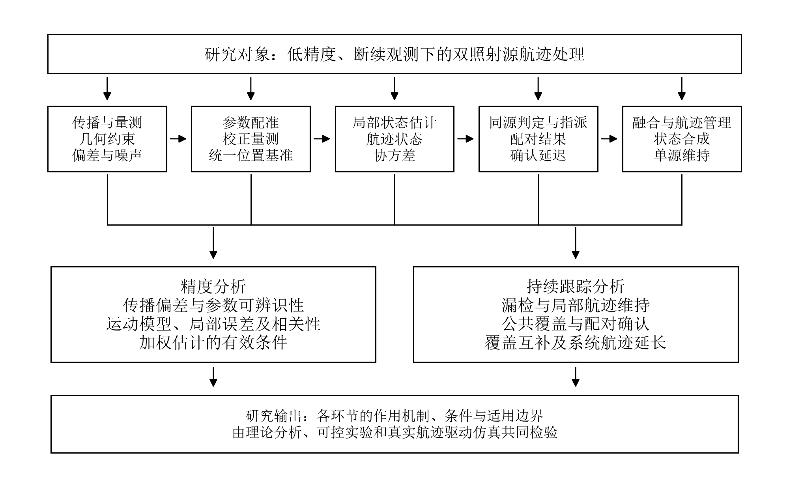{#fig:ch1_analysis}

沿此主线，系统评估拆分为精度与持续跟踪两条独立分析线索。精度线索围绕三个递进条件展开：系统传播与设备偏差是否得到参数化补偿、局部滤波运动模型与过程噪声是否适应目标机动、以及两站误差相关性和精度差异如何影响当前加权融合，并与实际在线收益有何差别。持续跟踪线索则聚焦信息在时空上的可获性，从覆盖几何提供的潜在观测并集出发，逐层考察漏检维持、配对确认延迟与航迹删除机制对实际有效观测时长的影响。

在研究边界上，本文限定为双照射源两条收发链路的航迹级处理，采用二维巡航目标运动模型与等效虚高单跳传播近似。为聚焦跨源关联与融合机理，单站内部点迹到局部航迹的关联视为理想条件，而局部航迹的量测噪声、漏检、初始化延迟、预测误差与断轨重起均完整保留。

## 1.4 主要研究内容

### 1.4.1 天波双基地量测与目标运动建模

建立包含等效虚高的双基地收发总群距离、方位角与多普勒速度量测方程，刻画三通道量测噪声、检测概率及单跳距离窗约束，并构建单站滤波所需的运动学模型。依托实测 ADS-B 航迹构建数据驱动的多场景仿真环境，在统一物理量测与检测条件下评估各处理环节。

对应误差分集与覆盖分集两类目标，设计近共视与覆盖互补两种站点布设方案：近共视布设用于共视段内的局部误差、相关性与融合精度机理分析，覆盖互补布设通过视差补偿错开波束，用于考察目标跨越不同覆盖区时的系统航迹延续能力。

### 1.4.2 传播参数与量测偏差的时空配准

严格区分采样时刻对齐与站源时基零点偏移两类时间因素：前者通过短时运动外推统一比较时刻，后者转化为群距离常数偏置纳入空间参数估计。以参考航迹为空间约束，构建等效虚高、距离偏置与方位偏差三参数加权最大似然估计模型，并在参数更新后基于双基地天波几何重新反演目标位置。

推导群距离参数 Fisher 信息矩阵与估计方差下界，定量分析参数耦合机理与标校集距离跨度的影响；结合 ADS-B 转弯航迹定位示例、蒙特卡洛重复标校及初始虚高失配对照实验，验证参数化配准对单站定位与后端融合的改善作用。

### 1.4.3 断续观测下的单照射源航迹滤波

采用交互多模型无迹卡尔曼滤波（IMM-UKF）处理非线性天波量测与目标转弯机动，建立经纬度状态与局部物理尺度之间的转换关系，设计基于滑窗逻辑的航迹确认、多量测加权起始及漏检预测维持机制。

面向连续白噪声加速度模型，开展过程噪声谱密度的蒙特卡洛加密扫参分析，兼顾位置均方根误差与归一化新息平方（NIS）、归一化估计误差平方（NEES）两项一致性统计量确定选定参数，随后在独立随机种子及附加 ADS-B 验证航迹上评估单站位置精度、连续输出比例与误差椭圆覆盖率。

### 1.4.4 有限公共观测下的跨照射源航迹配对

针对短共视及目标间距与定位误差相近时出现的关联歧义，以双门限作为在线主链路候选策略，并在同一逐帧处理框架中比较最近邻、序贯与多证据加权策略；系统管理器按候选分值进行当前帧一对一冲突消解，再通过多帧确认接入第二站。

基于非中心卡方分布与二项分布分析6/8在线确认规则的理想判别力，并以FR24覆盖互补场景和同链路策略对照考察配对表现，讨论默认双门限的适用范围及当前证据尚未覆盖的高并发条件。

### 1.4.5 相关误差下的航迹融合与持续跟踪

以简单凸组合（SCC）的信息矩阵加权为在线融合方法，分析误差独立性及协方差质量对融合的影响，推导静态标量模型下误差相关系数 $\rho$ 与标准差比 $k$ 所限定的非负收益条件，并在同帧配对评价中考察该边界与在线表现的差异。

在固定滤波参数和在线处理规则下，以共同目标—历元比较两组运动模型集的单站误差、中心化相关性及融合收益；在覆盖互补场景中分别统计几何覆盖实现率、实际航迹长度比与单源、双源段精度，检验两类收益的适用条件。

## 1.5 研究程序与方法

### 1.5.1 研究程序与技术路线

本文遵循“问题剖析—模型构建—离线标定—在线处理—对照验证”的研究程序，整体技术路线如图[@fig:ch1_route]所示。首先基于短波双基地传播机理与实测 ADS-B 交通流构建统一量测模型与评估场景，并将参考数据按时段划分为标校集与待测评估集，避免同一批数据同时用于参数拟合与性能检验。

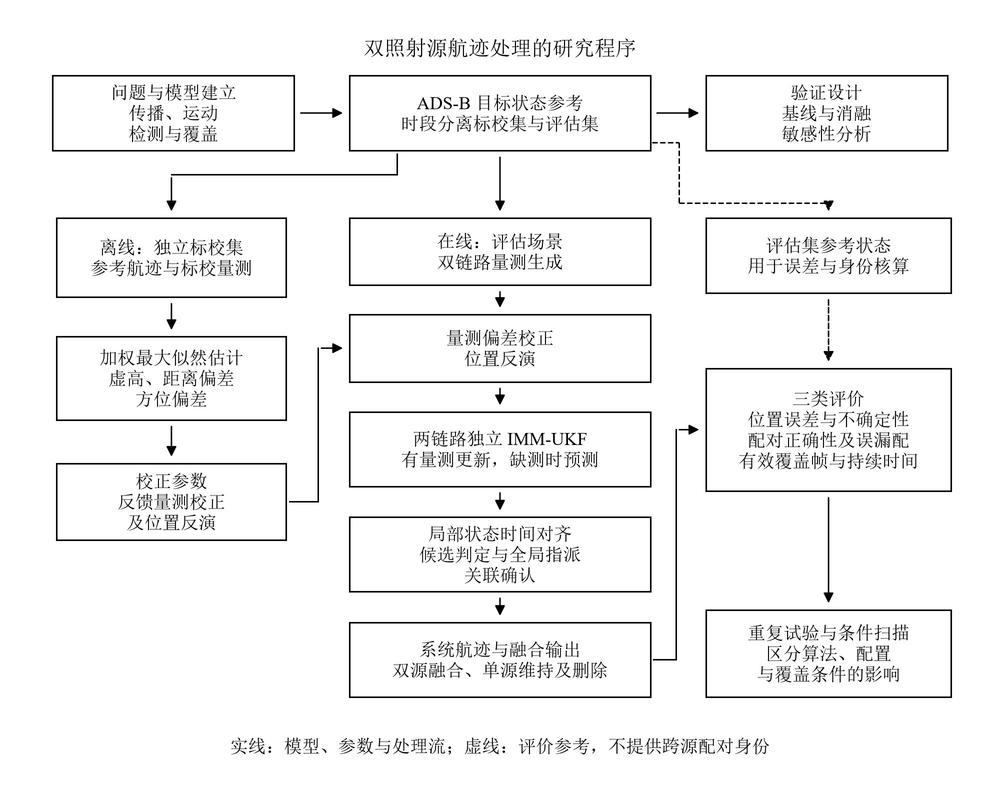{#fig:ch1_route}

在离线阶段，利用标校集分别估计两条链路的等效虚高与系统偏置参数，输出量测校正与位置反演所需的标定结果。在在线阶段，按 30 s 采样周期逐帧生成双链路仿真观测，各站独立完成偏置校正与 IMM-UKF 局部滤波；随后将有效局部航迹对齐至共同参考时刻，逐帧执行跨源候选判定、一对一冲突消解和多帧确认，并在源接入后进行状态融合。系统航迹支持单源起始、共视段双源接入以及离开共视区后的单源延续。全过程严格满足因果约束，时间对齐仅使用当前及历史局部状态，仿真参考真值仅用于量测生成、站内理想关联及事后误差核算，不向跨源配对泄露目标身份。

在验证设计上，采用配对随机条件逐级开展单环节与端到端对照实验，分别设置无偏差与有偏差、不同过程噪声与模型集、不同配对策略及覆盖布设条件，系统考察算法性能的稳定性与失效边界。

### 1.5.2 研究方法与验证方式

本文综合运用理论解析、算法对照与数据驱动仿真三类研究手段。理论分析层面，依托量测几何方程、Fisher 信息矩阵、非中心卡方判别分析以及线性最小方差推导，刻画配准可辨识性、确认帧数约束与融合有效边界；算法研究层面，围绕各环节核心问题采用加权极大似然估计、交互多模型非线性滤波、在线候选筛选与航迹管理及逆方差加权融合，并通过同链路策略对照分析配对方法的适用条件。

实验验证采用受控模型仿真与实测航迹驱动仿真相结合的方式。受控仿真用于精确改变机动形态、偏差大小与目标密度，检验理论推导的解析规律；数据驱动仿真则引入真实 ADS-B 航迹以保留现实航路几何、并发密度与非均匀机动特性，同时由天波双基地物理模型生成群距离、方位角、多普勒观测及检测序列。由于雷达量测与检测层仍基于物理模型仿真，本文结果属于实测轨迹驱动的仿真验证，而非真实短波回波外场实测。评价指标覆盖估计精度（均方根误差、中位数与 90 分位误差）、不确定性一致性（NIS、NEES 与误差椭圆覆盖率）、关联代价（按误配与漏配非对称加权）以及持续跟踪指标（长度比与几何上界实现度），并辅以多随机种子统计检验结果的稳健性。

# 第2章 天波双基地量测模型与场景构建

短波外辐射源雷达借助既有非合作照射源与电离层折射实现超视距目标探测。由于照射源与接收站空间分置，且电离层传播路径明显长于地面大圆距离，目标定位必须将天波传播几何与双基地量测模型结合求解。

在双照射源系统设计中，两条观测链路既可重叠布设以获取共视区误差分集，也可错开布设以获取互补区覆盖分集。两类布设对应的评估目标不同：前者侧重共视段内的跨源配对与融合精度，后者侧重目标穿越视场时的持续跟踪时长。覆盖重叠比例直接决定两者的取舍关系，而最终跟踪表现还受检测概率、航迹起始与站间关联机制制约。

本章首先明确近共视与覆盖互补两种站点布设及其分工，继而建立含等效虚高的天波双基地量测与定位反演模型，给出三通道噪声设定及几何精度稀释分析，最后阐述基于实测 ADS-B 数据的场景构造方法与模型边界假设。

## 2.1 两种布设及其分工

### 2.1.1 近共视布设

近共视布设令两条观测链路的探测区域高度重合，平面几何如图[@fig:ch2_layout](a)所示。北站 R1 位于 104.0°E、30.7°N，对应照射源 Tx1 位于 100.0°E、30.7°N；南站 R2 位于 106.5°E、29.6°N，对应照射源 Tx2 位于 102.5°E、29.6°N。两对收发站均沿东西向同纬度布设，经度间隔 4°（在 30°N 附近对应收发基线约 385 km），两接收站间距约 270 km。两站波束中心均指向 93°，视场全宽 45°，单跳地面距离窗设为 1000–2000 km。

该布设使两站能够同时观测大量共同目标，便于在统一条件下开展单站滤波、相关性分析及融合精度对比。尽管两站覆盖区域基本一致，但站点位置、双基地夹角与通道噪声水平互不相同，构成典型的异构双源观测场景。单跳距离窗（1000–2000 km）用于限定研究空域与量测生成范围。

### 2.1.2 覆盖互补布设与视差补偿

覆盖互补布设将两条链路的探测带沿南北方向错开，几何关系如图[@fig:ch2_layout](b)所示。北站 R1 位于 92.50°E、31.45°N，南站 R2 位于 92.50°E、30.55°N，两站南北相距约 100 km，各自照射源均位于正西 4° 且与接收站同纬度，波束总体朝东，视场全宽 15°。

由于两站存在南北间距 $\Delta y=100\text{ km}$，对同一目标走廊的观测存在不可忽略的几何视差，因此两站波束中心不能简单按对称方式设定。取走廊参考点 107.40°E、31.00°N，该点距 R1 与 R2 的地面距离分别为 1413.7 km 和 1420.4 km，对应观测方位角分别为 88.13° 和 84.17°，实测视差 3.96°。按平面小角近似估算，视差为

$$\Delta\theta_{\text{par}}\approx\arctan\frac{\Delta y}{\rho}=\arctan\frac{100}{1414}=4.05°$$ {#eq:ch2_parallax}

与实测值仅差 0.09°，表明在此探测距离下小角近似已具有足够精度。若两站波束平行指向正东，重叠区将偏向视场一侧，有效重叠角由 15° 降至约 11° 且偏离目标走廊。为此，本文以两站各自指向参考点的方位角为基准，分别向相反方向偏转 4.6°，得到两站波束中心为 83.53° 与 88.77°（中心间隔 5.24°），在 15° 视场宽度下形成约 9.76° 的居中重叠带。

经视差补偿后，沿走廊经线的覆盖分布为：R1 覆盖 30.36–33.66°N（南北跨度约 366 km），R2 覆盖 28.28–31.64°N（跨度约 373 km），两站在 30.36–31.64°N 之间重叠约 142 km，覆盖并集由 28.28°N 延伸至 33.66°N，总跨度约 597 km。南北向穿越走廊的目标依次经过仅 R2 可见、双站共视及仅 R1 可见三个区段，为研究跨视场航迹延续提供了清晰的几何结构。

### 2.1.3 两种布设的能力边界

两种布设各自承担不同的验证任务：近共视布设聚焦共视区内的多源融合精度机理，覆盖互补布设侧重检验跨覆盖区的持续跟踪与航迹延长能力。由于系统航迹的实际存续还受局部航迹起始、漏检维持及跨源配对确认延迟制约，覆盖并集刻画的是潜在观测几何上限，本文在后续评估中将持续跟踪指标与共视段精度指标分别统计。两种布设的全部系统参数汇总于表[@tbl:ch2_sysparam]。

| 参数 | 符号 | 近共视 | 覆盖互补 |
| ---- | ---- | ---- | ---- |
| R1 位置 | — | 104.0°E, 30.7°N | 92.50°E, 31.45°N |
| R2 位置 | — | 106.5°E, 29.6°N | 92.50°E, 30.55°N |
| 照射源 | — | 站正西 4° | 站正西 4° |
| 视场全宽 | — | 45° | 15° |
| 波束中心 | — | 93.0° / 93.0° | 83.53° / 88.77° |
| 单跳地面距离窗 | $\rho$ | 1000–2000 km | 1000–2000 km |
| 采样周期 | $dt$ | 30 s | 30 s |
| 检测概率 | $P_d$ | 0.6 | 0.6 |
| 虚警率 | $P_{fa}$ | $10^{-3}$ | $10^{-3}$ |
| R1 群距离噪声 | $\sigma_{R1}$ | 10 km | 10 km |
| R2 群距离噪声 | $\sigma_{R2}$ | 20 km | 20 km |
| R1 方位噪声 | $\sigma_{\theta1}$ | 0.35° | 0.35° |
| R2 方位噪声 | $\sigma_{\theta2}$ | 0.60° | 0.60° |
| 等效虚高（真值/标称） | $h$ | 320 / 300 km | 320 / 320 km |
| 目标巡航速度 | $v$ | 230 m/s | 230 m/s |

: 两种布设的系统参数 {#tbl:ch2_sysparam}

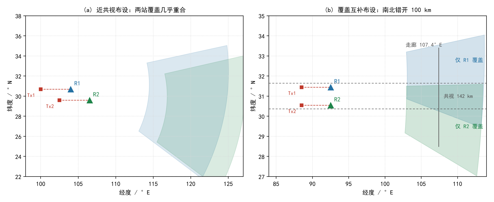{#fig:ch2_layout}

如图[@fig:ch2_layout]所示，两种布设的核心差异在于空间覆盖形态：图[@fig:ch2_layout](a) 中两站视场基本重合，覆盖并集与单站接近；图[@fig:ch2_layout](b) 中两束主动错开，并集跨度较单站（366 km 与 373 km）扩展约六成，但共视带宽度压缩至 142 km（约占并集的四分之一）。波束偏转角越大，覆盖并集越长，而留给跨源配对的共视段越短，这一几何权衡将在第 5 章确认窗设计中体现为直接约束。

## 2.2 天波传播的折线等效模型

### 2.2.1 等效虚高与单程路径长度

短波电磁波在电离层中经历连续折射，实际射线路径呈弧线，其群路径明显长于收发两点间的地面距离。由于电离层电子密度剖面随昼夜、季节与空间位置动态变化且难以先验精确获知，工程建模中常引入电离层等效虚高 $h$，将弯曲折射路径等效为在高度 $h$ 处发生镜面反射的对称折线。这一等效将复杂的介质分布压缩为单个可估标量，在有限的时空窗口内近似恒定。

设收发节点与目标之间的地面距离为 $\rho$，反射点位于该段中点上方高度 $h$ 处。由对称性，上下行斜距均为 $\sqrt{(\rho/2)^2+h^2}$，单程等效群路径为

$$L(\rho,h)=2\sqrt{\left(\frac{\rho}{2}\right)^2+h^2}=\sqrt{\rho^2+4h^2}$$ {#eq:ch2_oneway}

由式[@eq:ch2_oneway]可见，等效路径长度由地面距离与两倍虚高共同决定。当 $h=300\text{ km}$、$\rho=1400\text{ km}$ 时，$L=1523.2\text{ km}$，较地面距离多出约 123 km；在 $\rho=1000\text{ km}$ 与 $1900\text{ km}$ 处，路径增量占比分别约为 16.6% 与 4.9%。若定位反演忽略电离层虚高，将引入随目标距离剧烈变化的系统性距离高估。

在双基地配置下，记照射源至目标、目标至接收站的地面距离分别为 $\rho_0$ 与 $\rho_1$，两条路径各经一次电离层反射，收发总群距离为

$$R_g=L(\rho_0,h)+L(\rho_1,h)=\sqrt{\rho_0^2+4h^2}+\sqrt{\rho_1^2+4h^2}$$ {#eq:ch2_group_range}

为计入地球曲率影响，正演计算以球面弦长替代大圆弧长。取地球半径 $R_e=6371\text{ km}$，弧长 $\rho$ 对应的弦长为

$$\rho_c=2R_e\sin\frac{\rho}{2R_e}$$ {#eq:ch2_chord}

在 1000 km 与 2000 km 处，弦长分别比弧长短约 1.0 km 和 8.2 km。尽管该差值小于设定的群距离随机噪声，但仍属于随距离累积的系统偏差，因此本文正演模型统一采用球面弦长计算。

### 2.2.2 群距离的几何等值线与单基地近似的适用性

当 $h\to0$ 时，$L\to\rho$，平面等群距离线退化为以照射源和接收站为焦点的标准椭圆；在有限虚高下，等值线发生畸变。对式[@eq:ch2_oneway]按 $4h^2/\rho^2$ 作泰勒展开，有

$$L(\rho,h)=\rho\sqrt{1+\frac{4h^2}{\rho^2}}\approx\rho+\frac{2h^2}{\rho}-\frac{2h^4}{\rho^3}$$ {#eq:ch2_expand}

在 $\rho=1000\text{ km}$ 与 $1900\text{ km}$ 处，二阶截断残差分别为 $-2.4\text{ km}$ 和 $-0.1\text{ km}$，前者与第 3 章标定下界处于同一量级，因此本文全程采用式[@eq:ch2_group_range]的闭式表达，不作级数截断。

另一常见简化是将双基地群距离按平均地面距离 $\overline{\rho}=(\rho_0+\rho_1)/2$ 折算为单基地形式 $2L(\overline{\rho},h)$。记 $d=(\rho_0-\rho_1)/2$，由二阶展开可得双基地路径和与单基地近似的偏差为

$$L(\overline{\rho}+d)+L(\overline{\rho}-d)-2L(\overline{\rho})=L''(\overline{\rho}) d^2+\mathcal O(d^4), L''=\frac{4h^2}{L^3}$$ {#eq:ch2_monostatic}

由于该近似误差随收发基线长度、目标方位及距离显著变化，本文在定位与滤波中统一保留完整的双基地群距离模型。

### 2.2.3 群距离对虚高的灵敏度

等效虚高对群距离的偏导数决定了该参数能否从观测数据中准确辨识。对式[@eq:ch2_group_range]求偏导，得到虚高灵敏度函数

$$s(\rho_0,\rho_1,h)=\frac{\partial R_g}{\partial h}=\frac{4h}{\sqrt{\rho_0^2+4h^2}}+\frac{4h}{\sqrt{\rho_1^2+4h^2}}=\frac{4h}{L_0}+\frac{4h}{L_1}$$ {#eq:ch2_sens}

当 $\rho\gg2h$ 时，灵敏度近似按 $4h/\rho$ 随距离衰减。取 $h=300\text{ km}$：在近距（$\rho_0=680\text{ km}$、$\rho_1=300\text{ km}$）处 $s=3.11$；在 $\rho_0=\rho_1=1000\text{ km}$ 处 $s=2.06$；至远距 $\rho_0=\rho_1=1900\text{ km}$ 处降至 $s=1.20$。近端与远端灵敏度相差约 2.6 倍，说明同一虚高误差在不同探测距离处造成的群距离残差迥异，无法被常值距离偏置吸收。

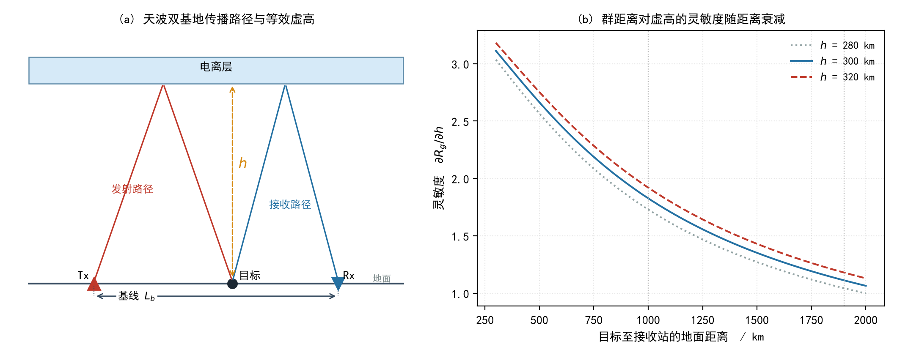{#fig:ch2_group_range}

如图[@fig:ch2_group_range]所示，灵敏度曲线由近端的 3.1 单调下降至远端的 1.1，且在 1000 km 以内斜率最陡。这一几何特征直接导出两条结论：一方面，近距段观测对虚高变化最为敏感，标校样本若缺乏足够的距离跨度，虚高与常值距离偏置将高度耦合；另一方面，灵敏度在不同距离上的离散程度构成了参数可辨识性的物理根源，其解析量化将在第 3 章通过 Fisher 信息矩阵给出。

## 2.3 定位反演与量测噪声

### 2.3.1 反演方程的可解性

由群距离与方位角反演目标位置时，需先求解目标至接收站的地面距离 $\rho_1$。记目标视线与收发基线的夹角为 $\psi$、基线长度为 $L_b$，在平面几何下由余弦定理 $\rho_0^2=\rho_1^2+L_b^2-2\rho_1L_b\cos\psi$ 代入式[@eq:ch2_group_range]，可得关于 $\rho_1$ 的标量方程

$$\sqrt{\rho_1^2+L_b^2-2\rho_1L_b\cos\psi+4h^2}+\sqrt{\rho_1^2+4h^2}-R_g=0$$ {#eq:ch2_inverse}

方程左端关于 $\rho_1$ 的导数为 $(\rho_1-L_b\cos\psi)/L_0+\rho_1/L_1$。当 $\rho_1>L_b$ 时两项均为正，函数严格单调递增，在可行区间内零点唯一；在本文 1000–2000 km 探测距离窗内（远大于 385 km 基线），该单调性条件自然满足。由单程路径不小于 $2h$ 可知 $R_g\ge4h$ 是有解的必要条件。数值实现上，程序先由经典双基地近似生成初值，再结合球面正算与天波模型预测值按比例迭代修正（上限 30 次），并校验收敛残差与距离窗范围。

### 2.3.2 方位与多普勒量测

单条观测链路在每个采样周期输出群距离、方位角与多普勒速度三维量测向量 $\mathbf z=[R_g,\phi_{az},v_d]^T+\boldsymbol\varepsilon_z$。多普勒速度对应总群距离对时间的变化率，在平面近似下由链式法则给出

$$v_d=\frac{\mathrm dR_g}{\mathrm dt}=\sum_{i=0}^{1}\frac{\rho_i}{L_i} \dot\rho_i=\frac{\rho_0}{L_0}\left(\mathbf e_0\cdot\mathbf v\right)+\frac{\rho_1}{L_1}\left(\mathbf e_1\cdot\mathbf v\right)$$ {#eq:ch2_doppler}

式中 $\mathbf e_0$、$\mathbf e_1$ 分别为照射源与接收站指向目标的单位方向矢量，目标远离时径向速度投影为正。在 $h=300\text{ km}$、距离 1000–1900 km 范围内，投影因子 $\rho_i/L_i$ 介于 0.857–0.954 之间；实际仿真程序中的球面弦长模型同时计入了弧长与弦长变化率的换算系数。

对投影因子求偏导得 $\partial(\rho/L)/\partial h=-4h\rho/L^3$。在 $\rho=1400\text{ km}$、$h=300\text{ km}$ 附近，虚高变化 20 km 仅引起约 1% 的投影权重偏移，表明多普勒通道对虚高误差的敏感度远低于群距离通道。

### 2.3.3 三通道噪声的量级与几何稀释

仿真设定三个量测通道的随机噪声相互独立且服从零均值高斯分布，量测噪声协方差矩阵为对角阵

$$\mathbf R=\operatorname{diag}(\sigma_R^2,\sigma_\theta^2,\sigma_{vd}^2)$$ {#eq:ch2_cov}

为构造性能不对称的双照射源对照场景，两条链路的群距离噪声标准差分别设为 10 km 与 20 km，方位角噪声标准差分别设为 0.35° 与 0.60°，多普勒速度噪声标准差均设为 0.5 m/s。由于三通道物理量纲与误差量级差异悬殊，第 3 章的参数估计将按各通道方差对残差作归一化加权。

观测几何还会进一步放大或调制量测噪声向位置空间的映射。记二维位置矢量为 $\mathbf p=[x,y]^T$，距离与方位观测对位置的雅可比矩阵为

$$\mathbf H_k=\begin{bmatrix}\dfrac{\rho_0}{L_0}\mathbf e_0^T+\dfrac{\rho_1}{L_1}\mathbf e_1^T\\[6pt] \dfrac{1}{\rho_1}\mathbf u^T\end{bmatrix}$$ {#eq:ch2_jac}

式中 $\mathbf u$ 为与接收站视线正交的单位矢量。令距离与方位二维噪声协方差为 $\mathbf R_{R\theta}=\operatorname{diag}(\sigma_R^2,\sigma_\theta^2)$（方位角以弧度计），在信息矩阵可逆的静态位置观测下，位置估计的克拉美-罗下界（CRLB）为

$$\mathbf P_{\text{pos}}=\left(\sum_k\mathbf H_k^T\mathbf R_{R\theta}^{-1}\mathbf H_k\right)^{-1}$$ {#eq:ch2_gdop}

以收发传播方向近似平行为例，群距离对径向位置的导数约为 $2\rho/L$。在 $\rho=1400\text{ km}$、$h=300\text{ km}$ 处，10 km 的群距离标准差折合径向位置标准差约为 $10/(2\times0.919)=5.4\text{ km}$，而 0.35° 的方位标准差折合切向位置标准差约为 8.6 km，可见远距天波探测中方位误差对横向定位精度的制约尤为突出。

## 2.4 数据驱动的场景构建

### 2.4.1 数据来源与筛选准则

纯人工合成航迹的交叉几何、转弯时机与目标并发密度均由设计者预设，难以客观检验跨照射源配对算法在真实交通流下的适应性。为此，本文采用实测广播式自动相关监视（ADS-B）航迹作为目标运动真值，仅由天波物理模型与检测模型生成雷达观测数据，构成实测航迹驱动的仿真场景。

原始数据取自 2026 年 10 月 24 日全天中国区域 ADS-B 广播记录（约 776 MB、670 万行，清洗越界与缺失字段后保留约 590 万行）。航迹筛选遵循五项准则：空间限定于走廊经度 104–112.5°E、纬度 22–40°N；飞行高度不低于 20000 ft 以聚焦高空巡航段；单段航迹不少于 10 帧；地速处于 120–620 kt 合理区间；相邻记录时间间隔超过 120 s 即截断为独立航迹，避免长缺口插值伪造轨迹。筛选后的航迹重采样至严格 30 s 网格，与原始采样间隔中位数（30 s）及雷达仿真采样周期自然一致。

### 2.4.2 场景规模与覆盖结构

按上述流程构建的主场景记为 adsb_ns_all，基本规模如表[@tbl:ch2_scene]所示，包含 57 条航迹、2 033 帧、12 281 个目标帧，覆盖 07:03–23:59 UTC 时段。57 条航迹由 37 条穿越走廊的南北向航迹与 20 条远距航迹组成，后者用于检验距离窗边缘特性并为标校集补充距离跨度。经时间断点与视场进出切分后，共形成 63 段航迹，其中 57 段曾同时落入两站视场（构成第 5 章跨源配对的候选池），其余 6 段全程仅单站可见。

| 场景 | 航迹数 | 帧数 | 目标帧 | 并发均值 | 并发峰值 | 时段(UTC) |
| ---- | ---- | ---- | ---- | ---- | ---- | ---- |
| adsb_ns_all | 57（63 段） | 2 033 | 12 281 | 6.0 | 12 | 07–24 |

: 主场景规模 {#tbl:ch2_scene}

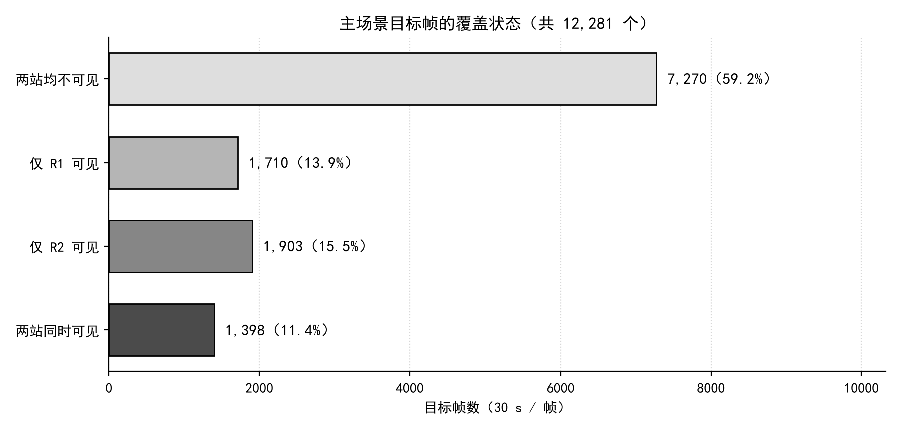{#fig:ch2_density}

图[@fig:ch2_density]统计了全部 12 281 个目标帧的几何覆盖分布：两站均不可见 7 270 帧，仅 R1 可见 1 710 帧，仅 R2 可见 1 903 帧，双站同时可见 1 398 帧。落入 R1 与 R2 视场的目标帧分别为 3 108 帧和 3 301 帧，共视帧约占总目标帧的 11%。需要指出，该统计反映的是几何可见性，实际形成确认航迹的帧数还受检测概率与航迹管理规则影响。

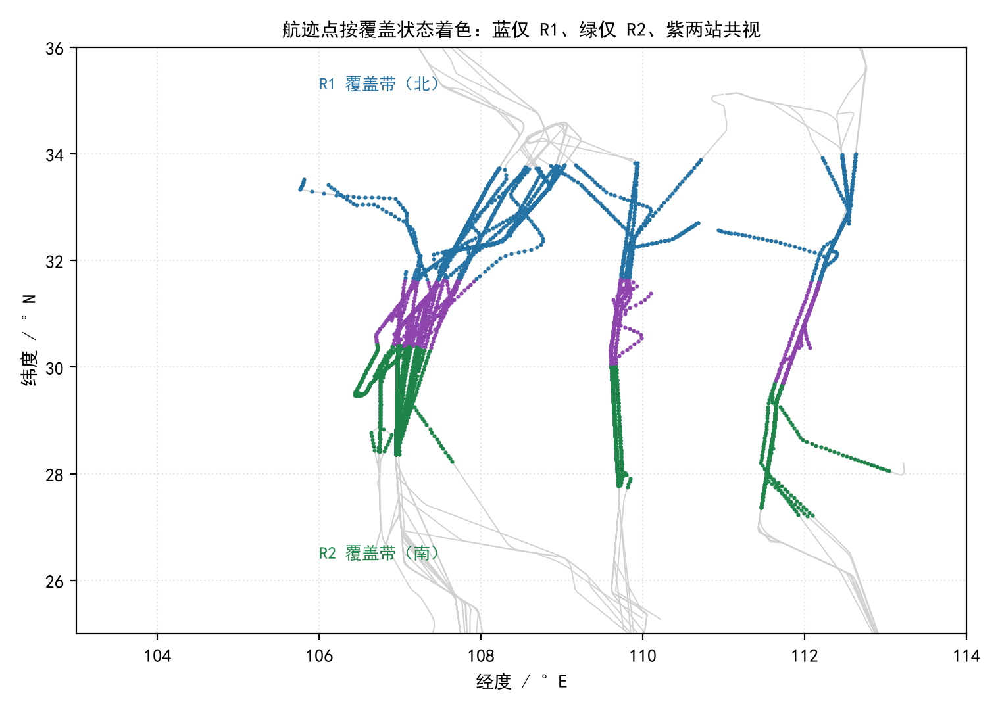{#fig:ch2_tracks}

从图[@fig:ch2_tracks]的空间分布可以看出，大量南北向穿越航迹依次途经单站覆盖区、双站共视带及另一单站覆盖区。若将共视带近似为宽度为 $W$ 的平行带，航迹航向与覆盖带边界法向夹角为 $\alpha$，则穿越长度可近似估算为

$$L_{\text{cov}}\approx\frac{W}{\cos\alpha}$$ {#eq:ch2_covlen}

实际穿越长度随航向变化与扇区边界形状有所差异，后续跨源配对分析将以逐帧统计的真实共现帧数为准。

## 2.5 模型边界与显式假设

为清晰界定研究范围，本文后续各章的建模与仿真统一建立在以下前提条件之上。

**A0（站内关联理想假设）**：单站内部的点迹—航迹关联视为理想，即检测到的目标量测无误地分配至对应局部航迹；局部航迹的位置误差仅来源于量测噪声、漏检及滤波模型误差，不含站内杂波误关联。

引入假设 A0 旨在将单站杂波数据关联与站间跨源航迹配对剥离，使研究聚焦于双照射源协同处理机理。在此前提下，系统仍须完整应对大随机噪声、40% 漏检率、机动模型失配、航迹断轨重起以及密集多目标跨源歧义等核心难题。同时，目标运动限定于二维巡航平面，电离层传播采用单跳标量等效虚高近似，不直接模拟目标高度爬升、电离层水平梯度与多跳混合回波；雷达群距离、方位、多普勒量测及检测过程均由物理模型仿真生成，实验结论属于实测航迹驱动的仿真验证，并限定在上述模型假设范围内解释。

## 2.6 本章小结

本章确立了全文的几何构型、物理量测方程与数据驱动验证框架。站点布设方面，区分近共视与覆盖互补两类配置，通过视差补偿在覆盖互补布设中构造出 597 km 的覆盖并集与 142 km 的居中共视带。量测建模方面，建立了基于球面弦长与等效虚高的双基地群距离、方位及多普勒模型，揭示了虚高灵敏度随距离衰减约 2.6 倍的非线性特征，并给出了反演单调区间与几何精度稀释关系。场景构建方面，依托实测 ADS-B 航迹形成了包含 57 条航迹（63 段）的主场景，并明确了站内理想关联（A0）及二维等效传播等模型边界。下一章将在此量测模型基础上，研究双照射源系统偏差的联合参数标定与空间配准问题。

# 第3章 双照射源时空配准

在双照射源天波体制下，同一目标经两条独立传播链路反演得到的航迹往往存在系统性位置偏移，其根源既包含距离与方位的设备零点误差，也包含标称等效虚高与真实电离层状态之间的传播模型失配。若未加校正便直接开展站间关联与融合，系统偏差既会引发同源漏配或异源误配，也会污染融合后的状态估计。因此，在站间航迹处理之前，必须建立与天波传播机理相一致的参数化配准模型，将各链路观测统一至可比的时空基准。

本章以外部参考航迹作为空间约束，将等效虚高、时基失配对应的距离偏置与方位偏差纳入同一观测模型，提出多航迹联合加权参数估计与位置重解算方法；继而从 Fisher 信息矩阵出发分析参数耦合机理与标校几何条件，并结合 ADS-B 转弯航迹定位、重复标校仿真与初始虚高失配对照验证算法性能及适用边界。

## 3.1 配准问题与参考信息

### 3.1.1 时间基准与观测时刻

双照射源系统中的时间因素主要表现为两类性质不同的误差。其一是接收站与非合作照射源之间的时基同步残差 $\Delta t$，它会改变传播时延的参考零点，在按总传播路径定义的群距离中直接引入附加偏置

$$\Delta R_{\text{sync}}=c\Delta t$$ {#eq:ch3_tr_sync}

式中 $c$ 为电磁波传播速度。由于此处群距离对应发射与接收路径之和，式[@eq:ch3_tr_sync]不含单基地往返测距中的二分之一系数；在单一标校窗口内，该时基偏置可近似视为常数。

其二是两站局部航迹采样时刻不一致引起的异步偏差。即便不存在时基零点误差，两站状态也需外推至共同参考时刻才能计算位置差异或执行融合。对局部平面状态 $\mathbf x=[p_E,v_E,p_N,v_N]^T$，短时匀速对齐可写为

$$\mathbf x(t)=\mathbf F(\Delta\tau)\mathbf x_k,\mathbf F(\Delta\tau)=\begin{bmatrix}1&\Delta\tau&0&0\\0&1&0&0\\0&0&1&\Delta\tau\\0&0&0&1\end{bmatrix}$$ {#eq:ch3_time_align}

式中 $\Delta\tau=t-t_k$，状态协方差随转移矩阵同步传播并叠加相应过程噪声。在线对齐严格遵循因果性，仅利用当前已获取的局部估计向前外推；当目标发生强机动或外推步长较长时，匀速外推误差会相应增大。本文据此将两类时间问题分开处理：已知采样偏移通过状态外推在线对齐，未知站源时基残差则转化为距离偏置 $\Delta R_{\text{sync}}$ 进行离线参数标定。

### 3.1.2 参考航迹与链路参数

在离线标校阶段，外部参考航迹提供目标在各时刻的精确位置，雷达观测链路输出对应的群距离与方位角，二者构成参数估计的观测对。本节假定标校所用的参考航迹与雷达观测已完成正确对应，且参考位置误差远小于雷达量测误差。基于第 2 章的天波双基地量测模型（省去链路下标），群距离与方位观测方程可写为

$$R_{g,k}^{\text{obs}}=\sqrt{D_{0,k}^2+4h^2}+\sqrt{D_{1,k}^2+4h^2}+\Delta R_{\text{sync}}+\varepsilon_{R,k}$$ {#eq:ch3_obs_range}

&#8203;

$$\phi_{az,k}^{\text{obs}}=\phi_k^{\text{ref}}+\Delta\theta+\varepsilon_{\theta,k}$$ {#eq:ch3_obs_az}

式中 $D_{0,k}$、$D_{1,k}$ 分别为照射源与接收站至参考目标位置的球面弦长，$\phi_k^{\text{ref}}$ 为接收站指向目标的大圆初始方位角，待估链路参数矢量为 $\boldsymbol\eta=[h,\Delta R_{\text{sync}},\Delta\theta]^T$。三类参数对定位的作用机理各不相同：等效虚高改变传播折线几何，距离偏置平移群距离零点，方位偏差旋转观测视线，因此无法用固定二维平面平移替代三参数联合校正。

同一链路在标校窗口内的多条参考航迹共享同一组参数 $\boldsymbol\eta$。考虑到两条观测链路的电离层反射区与接收通道偏差各自不同，本文对两条链路分别独立估计三参数，不强行约束两站虚高相等。

## 3.2 多航迹联合参数估计与位置校正

### 3.2.1 加权估计准则

设某条链路在标校窗口内共有 $M$ 条参考航迹，第 $m$ 条航迹包含 $N_m$ 个有效观测对。将实际观测减去由参考位置与待估参数 $\boldsymbol\eta$ 预测的群距离与方位，得到残差 $r_{R,k}^{(m)}$ 和 $r_{\theta,k}^{(m)}$（方位残差按周期归一化至 $[-\pi,\pi)$ 以消除跨 0°/360° 边界跳变）。构造按噪声方差归一化的加权非线性最小二乘目标函数

$$J(\boldsymbol\eta)=\sum_{m=1}^{M}\sum_{k=1}^{N_m}\left[\frac{\left(r_{R,k}^{(m)}\right)^2}{\left(\sigma_R^{(m)}\right)^2}+\frac{\left(r_{\theta,k}^{(m)}\right)^2}{\left(\sigma_\theta^{(m)}\right)^2}\right]$$ {#eq:ch3_cost}

在各观测通道噪声相互独立且服从零均值高斯分布的条件下，极小化式[@eq:ch3_cost]等价于加权最大似然估计，既消除了距离与角度的量纲差异，也依据观测精度合理分配了权重。若实际通道或相邻时刻存在显著误差相关性，则需引入完整噪声协方差矩阵的逆构造广义最小二乘准则。

为将优化解约束在物理可行区间内，本文引入 Logistic 变量映射，将物理参数 $\eta_j$ 转化为无约束变量 $u_j$ 后采用列文伯格—马夸尔特（Levenberg–Marquardt）算法迭代求解：

$$\eta_j=\eta_{j,\min}+\frac{\eta_{j,\max}-\eta_{j,\min}}{1+\exp(-u_j)},j=1,2,3$$ {#eq:ch3_logistic}

具体实现中，等效虚高可行范围取 200–500 km（初值 300 km），距离偏置范围取 −100–100 km（初值 0），方位偏差范围取 −10°–10°（初值 0）。

### 3.2.2 传播参数更新与位置重解算

获取参数估计值 $\hat{\boldsymbol\eta}=[\hat h,\widehat{\Delta R}_{\text{sync}},\widehat{\Delta\theta}]^T$ 后，先对原始观测量扣除常值零点偏置：

$$\widehat R_{g,k}=R_{g,k}^{\text{obs}}-\widehat{\Delta R}_{\text{sync}},\widehat\phi_{az,k}=\phi_{az,k}^{\text{obs}}-\widehat{\Delta\theta}$$ {#eq:ch3_correct}

再以估计虚高 $\hat h$ 替换标称虚高，代入第 2 章的球面双基地反演程序重新解算目标位置。仅扣除常值偏置而不更新传播模型参数时，随目标距离变化的电离层失配仍会残留；因此参数估计、零点校正与虚高更新必须闭环衔接，完整流程如图[@fig:ch3_registration_flow]所示。

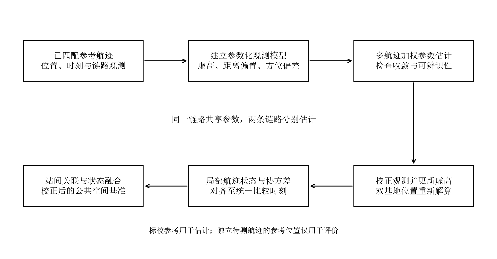{#fig:ch3_registration_flow}

虚高估计残差 $\delta h$ 向地面距离反演误差的传递关系可借助平面局部线性化近似说明。记群距离沿观测方向对地面距离 $\rho_1$ 的导数为 $G_\rho=\partial R_g/\partial\rho_1$，在观测群距离不变时有

$$\delta\rho_1\approx-\frac{\partial R_g/\partial h}{G_\rho}\delta h,G_\rho=\frac{\partial R_g}{\partial\rho_1}$$ {#eq:ch3_h2pos}

可见，相同的虚高估计残差在不同几何位置引起的定位偏差由虚高灵敏度与反演几何因子共同放大或衰减，评估标校质量时应结合最终定位误差而非孤立看待参数绝对偏差。

## 3.3 参数可辨识性与标校数据条件

### 3.3.1 距离参数的耦合

由于等效虚高 $h$ 与距离偏置 $\Delta R_{\text{sync}}$ 同时作用于群距离通道，二者在参数估计中存在天然耦合。记第 $k$ 个观测处的虚高灵敏度为

$$s_k=\frac{\partial R_g}{\partial h}=\frac{4h}{\sqrt{D_{0,k}^2+4h^2}}+\frac{4h}{\sqrt{D_{1,k}^2+4h^2}}$$ {#eq:ch3_sens}

在参数真值附近作一阶展开，群距离微扰满足

$$\delta R_{g,k}\approx s_k\delta h+\delta(\Delta R_{\text{sync}})$$ {#eq:ch3_first_order}

若标校样本集中于相近距离，各点灵敏度 $s_k$ 几乎恒定，则虚高变化 $s_k\delta h$ 与常值偏置 $\delta(\Delta R_{\text{sync}})$ 彼此抵消，残差几乎不变，导致两参数难以分离。设独立观测总数为 $N=\sum_mN_m$，距离噪声方差恒为 $\sigma_R^2$，定义样本均值 $\overline s=N^{-1}\sum_ks_k$ 与二阶矩 $\overline{s^2}=N^{-1}\sum_ks_k^2$，则距离子参数 $[h,\Delta R_{\text{sync}}]^T$ 的 Fisher 信息矩阵为

$$\mathbf F_R=\frac{N}{\sigma_R^2}\begin{bmatrix}\overline{s^2}&\overline s\\\overline s&1\end{bmatrix}$$ {#eq:ch3_fisher}

矩阵 $\mathbf F_R$ 的行列式正比于灵敏度方差 $v_s=\overline{s^2}-\overline{s}^2$：当且仅当 $v_s>0$ 时，虚高与距离偏置在一阶局部意义下可辨识；当标校目标距离分布过窄导致 $v_s\to0$ 时，信息矩阵趋于奇异。在参考位置已知且测距、测角噪声独立的条件下，方位偏差 $\Delta\theta$ 不进入群距离方程，其估计在信息矩阵中与距离参数解耦。

### 3.3.2 估计下界与观测几何

当 $v_s>0$ 时，对式[@eq:ch3_fisher]求逆得到距离子参数的克拉美-罗协方差下界

$$\mathbf F_R^{-1}=\frac{\sigma_R^2}{Nv_s}\begin{bmatrix}1&-\overline s\\-\overline s&\overline{s^2}\end{bmatrix}$$ {#eq:ch3_finv}

取对角元素平方根，得到等效虚高与距离偏置的标准差下界：

$$\sigma_{h,\mathrm{LB}}=\frac{\sigma_R}{\sqrt{Nv_s}},\sigma_{\Delta R,\mathrm{LB}}=\frac{\sigma_R}{\sqrt N}\frac{\sqrt{\overline{s^2}}}{\sqrt{v_s}}$$ {#eq:ch3_crlb}

引入灵敏度变异系数 $\mathrm{CV}(s)=\sqrt{v_s}/\overline s$，距离偏置下界可改写为 $\sigma_{\Delta R,\mathrm{LB}}=\alpha\sigma_R/\sqrt N$，其中由参数耦合引入的几何放大因子为

$$\alpha=\frac{\sqrt{1+\mathrm{CV}^2(s)}}{\mathrm{CV}(s)}$$ {#eq:ch3_alpha}

式[@eq:ch3_crlb]与式[@eq:ch3_alpha]清晰分离了样本规模与几何构型的作用：在固定观测几何下，增加独立样本按 $N^{-1/2}$ 降低估计标准差；而扩大标校航迹的距离跨度以提升 $\mathrm{CV}(s)$，则直接压低几何放大因子 $\alpha$，解除两参数相互补偿导致的方差膨胀。进一步由式[@eq:ch3_finv]可得两参数估计误差的相关系数

$$\rho_{h,\Delta R}=-\frac{\overline s}{\sqrt{\overline{s^2}}}=-\frac{1}{\sqrt{1+\mathrm{CV}^2(s)}}$$ {#eq:ch3_corr}

负相关系数越接近 −1，说明耦合越强，但判断估计精度是否达标仍须结合具体噪声水平、样本量与下界数值，而非仅凭相关系数高低。图[@fig:ch3_crlb]直观展示了几何放大因子随 $\mathrm{CV}(s)$ 的陡降特征，以及不同几何离散度下样本数积累对估计下界的影响。

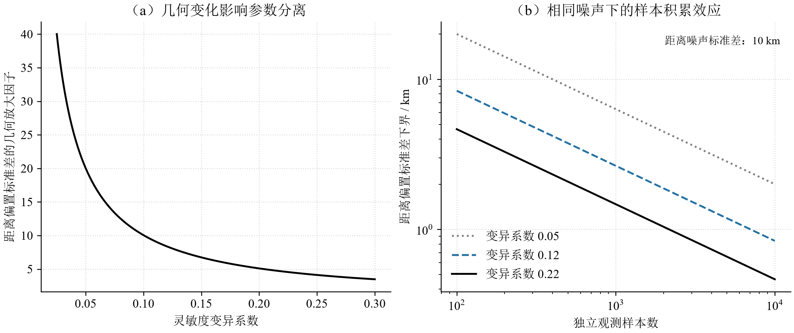{#fig:ch3_crlb}

### 3.3.3 多航迹标校集的构造原则

上述解析结果直接指导标校数据的组织策略。多航迹联合标校的核心价值在于通过跨距离段的参考航迹拉开灵敏度 $s_k$ 的变化区间，提升 $\mathrm{CV}(s)$，而不在于简单堆砌处于同一距离带的航迹条数。同时，克拉美-罗下界以窗口内参数恒定与观测独立为前提：过度拉长标校时间窗口虽然增加了名义样本数，却容易引入电离层昼夜漂移；相邻高频采样若存在时间相关性，有效独立信息量也将低于名义点数。工程上需在传播稳定性与距离跨度之间折中选取标校窗口。

## 3.4 ADS-B 数据驱动仿真验证

### 3.4.1 转弯航迹的位置配准

为直观检验三参数校正对不同航向与观测几何的补偿效果，从第 2 章主场景中选取一段具有明显航向变化的 ADS-B 航迹（编号 T06677，时段 07:55:28—08:33:28 UTC，共 77 个 30 s 采样点，平滑首尾航向变化约 43°）作为独立待测轨迹。选取过程仅依据覆盖连续性与转弯形态，不参考配准误差。

仿真采用覆盖互补布设的 R1 链路，设置真实等效虚高 $h=320\text{ km}$、距离偏置 $\Delta R_{\text{sync}}=+20\text{ km}$、方位偏差 $\Delta\theta=-3°$，群距离与方位噪声标准差分别为 10 km 与 0.35°。标校参数由 12:00—18:00 UTC 时段的参考航迹集独立估计得到，该标校集不包含待测航迹 T06677。待测航迹各时刻生成固定随机种子的仿真量测，配准前按标称虚高 300 km 且不扣除系统偏置直接反演，配准后利用估计参数校正并重解算；本例关闭漏检、滤波与跨源关联，以孤立观察单点定位校正效果。

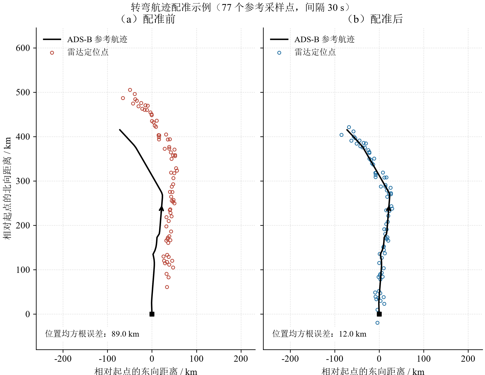{#fig:ch3_registration_demo}

如图[@fig:ch3_registration_demo]所示（两子图采用相同地理坐标范围与等比例尺度），配准前的定位点整体显著偏离参考轨迹，且偏移矢量随目标位置与观测方位不断变化；经三参数联合配准后，定位点紧贴参考轨迹分布，仅保留量测噪声引起的随机散布。此次仿真中，逐点定位均方根误差由 89.0 km 降至 12.0 km，表明参数化校正有效消除了结构性系统偏移。

### 3.4.2 参数估计与理论下界的比较

为检验估计器精度与理论信息下界的一致性，在固定站点构型、标校参考航迹几何与真值参数条件下，采用 10 个独立随机种子重复生成量测并执行三参数估计。R1 与 R2 两条链路分别包含 4 215 和 5 454 个有效观测点对，重复统计结果及理论标准差下界均值汇总于表[@tbl:ch3_mc]。

| 链路 | 参数 | 真值 | 估计均值 | 样本标准差 | 标准差下界 |
| ---- | ---- | ---- | ---- | ---- | ---- |
| R1 | $h$ / km | 320 | 320.230 | 1.027 | 0.921 |
| R1 | $\Delta R_{\text{sync}}$ / km | 20 | 19.625 | 1.343 | 1.286 |
| R1 | $\Delta\theta$ / ° | −3 | −2.999 | 0.0068 | 0.0054 |
| R2 | $h$ / km | 320 | 319.962 | 1.872 | 1.538 |
| R2 | $\Delta R_{\text{sync}}$ / km | −15 | −14.916 | 2.533 | 2.157 |
| R2 | $\Delta\theta$ / ° | 3.5 | 3.504 | 0.0088 | 0.0081 |

: 固定标校几何下 10 次独立噪声实现的参数估计统计 {#tbl:ch3_mc}

从表[@tbl:ch3_mc]可见，各参数的估计均值均紧邻设定真值，10 次实现的样本标准差约为对应理论下界的 1.04–1.26 倍，实测误差量级与式[@eq:ch3_crlb]给出的局部信息分析高度吻合。值得注意的是，R2 链路的观测样本数（5 454）多于 R1（4 215），但其参数估计标准差反而明显大于 R1，这与 R2 更高的通道噪声及具体几何分布有关，从侧面印证了单凭样本数量无法决定标校精度。

### 3.4.3 初始虚高失配对后续处理的影响

进一步在覆盖互补场景下考察传播参数失配向后端融合的传导效应。固定真实虚高为 320 km、两站常值距离与方位偏置为零，令初始标称虚高与真值分别相差 0、10、20、40 km，在每档失配下对比“不配准”与“三参数配准”两条支路（每档 3 个随机种子），结果如图[@fig:ch3_e7]所示。

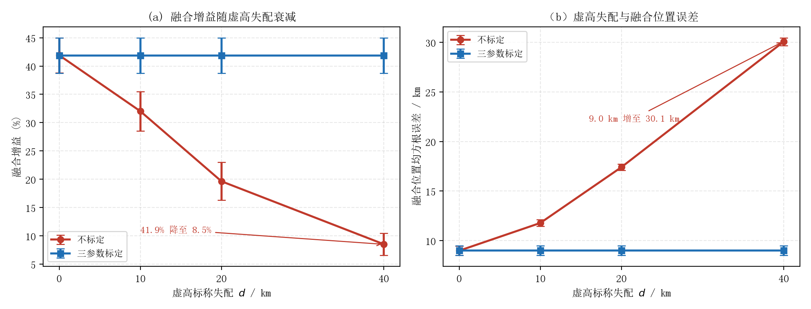{#fig:ch3_e7}

在不配准条件下，随着初始虚高失配由 0 km 增至 40 km，共视段融合位置 RMSE 均值从 8.98 km 急剧恶化至 30.07 km，同口径融合增益由 41.9% 跌至 8.5%；而启用三参数配准后，四种初始失配下的融合 RMSE 均稳定保持在约 8.99 km，融合增益维持在 41.9% 左右。需要说明的是，该端到端对照采用全天主场景，与 12:00—18:00 UTC 标校窗口存在时段交集，故本实验主要反映传播模型一致条件下虚高重估对消除初始失配的有效性，而独立待测泛化能力由 3.4.1 节的分离航迹示例补充验证。

## 3.5 模型适用范围与残余误差

本章方法在实际应用中受若干物理与统计边界制约。首先，标校窗口内假定等效虚高与设备偏置为恒定标量，而在真实电离层环境中，虚高存在昼夜演变与空间水平梯度；当估计参数跨时段外推使用时，需监控观测残差变化并在必要时触发重标校。其次，由于 $h$ 与 $\Delta R_{\text{sync}}$ 存在强负相关，若场景中存在未建模的电离层空间倾斜，优化解可能沿 $h$–$\Delta R$ 耦合方向漂移，即便训练残差较小也不代表单个物理参数绝对准确，因此标校验收应同时检查信息矩阵条件与独立待测航迹的定位误差。

此外，标校阶段的参数估计残差会持续作用于后续整个观测周期，导致不同时刻的局部定位误差具有一定时间相关性；若两站共用同一套外部参考航迹，残余误差还可能引入跨站相关性。同时，加权最小二乘准则对参考航迹误配及异常粗差较为敏感，在真实外场短波数据应用中需辅以抗差估计与质量控制。

## 3.6 本章小结

本章构建了面向双照射源天波体制的三参数联合时空配准方法。通过区分采样异步对齐与站源时基偏置，将等效虚高、距离零点偏置与方位偏差纳入统一观测方程，借助多航迹加权最大似然估计完成参数反演与位置重解算。Fisher 信息矩阵解析推导表明，虚高与距离偏置的可分离性取决于观测集合的灵敏度变异系数 $\mathrm{CV}(s)$，放大因子 $\alpha$ 定量刻画了标校距离跨度对估计下界的约束。ADS-B 转弯航迹定位示例将逐点位置误差由 89.0 km 压降至 12.0 km，10 种子重复标校实测标准差为理论下界的 1.04–1.26 倍，初始虚高失配对照则验证了虚高更新可将 40 km 失配造成的融合误差由 30.07 km 恢复至 8.99 km。下一章将在已校正观测的基础上，研究断续量测条件下的单站机动目标滤波与航迹维持。

# 第4章 单站机动目标航迹滤波

经第 3 章的偏差校正与虚高更新后，两条链路的系统性定位偏移得到有效抑制，但观测数据仍包含较大的随机噪声，且在低检测概率条件下频繁漏检。单帧逐点定位不仅随机波动剧烈，也无法提供目标速度估计和漏检期间的连续位置预测。因此，单站滤波的核心任务是在观测噪声抑制与机动快速响应之间取得平衡，递推输出连续的目标状态及协方差估计，为下游跨照射源配对与融合奠定输入基础。

本章围绕交互多模型无迹卡尔曼滤波（IMM-UKF），依次阐述经纬度状态与协调转弯运动模型、完整预测协方差无迹采样与多模型交互算法，以及断续观测下的滑窗确认与漏检维持机制。在此基础上，按照“影响机理—蒙特卡洛扫参—参数选择—性能验证”的流程开展过程噪声谱密度分析，并利用受控运动轨迹与实测 ADS-B 转弯轨迹系统评估滤波的位置精度、连续输出比例及协方差统计一致性。

## 4.1 单站跟踪问题与状态模型

### 4.1.1 状态定义与运动描述

单站滤波器接收经时空配准校正后的群距离、方位角与多普勒速度三维量测，直接输出公共地理坐标系下的目标状态矢量及其协方差矩阵。状态矢量定义为

$$\mathbf x_k=[\lambda_k,\dot\lambda_k,\varphi_k,\dot\varphi_k]^T$$ {#eq:ch4_state}

式中 $\lambda_k$、$\varphi_k$ 分别为目标的经度与纬度，$\dot\lambda_k$、$\dot\varphi_k$ 为对应角变化率（单位：°/s）。在地理坐标下递推便于直接对接球面天波量测函数及跨站航迹对齐；在计算物理速度、过程噪声与位置误差时，按所在纬度将经纬度分量换算至局部东北物理尺度。

目标运动采用匀速（CV）与定常转弯率协调转弯（CT）组合建模。在局部东北平面状态 $[p_E,v_E,p_N,v_N]^T$ 下，转弯率为 $\omega$ 时的离散状态转移矩阵为

$$\mathbf F_{CT}(\omega)=\begin{bmatrix}1&\dfrac{\sin(\omega\Delta t)}{\omega}&0&-\dfrac{1-\cos(\omega\Delta t)}{\omega}\\0&\cos(\omega\Delta t)&0&-\sin(\omega\Delta t)\\0&\dfrac{1-\cos(\omega\Delta t)}{\omega}&1&\dfrac{\sin(\omega\Delta t)}{\omega}\\0&\sin(\omega\Delta t)&0&\cos(\omega\Delta t)\end{bmatrix}$$ {#eq:ch4_ct}

约定 $\omega>0$ 表示左转、$\omega<0$ 表示右转；当 $\omega\to0$ 时，式[@eq:ch4_ct]自然退化为匀速直线转移矩阵。递推预测时，先将当前经纬度速度转换至局部东北平面完成位移与速度更新，再经球面正算映射回新的经纬度及其变化率。各候选转弯率仅作为多模型滤波的假设集合，不预先依赖目标真实机动信息。

### 4.1.2 量测与噪声模型

滤波观测方程沿用第 2 章建立的球面天波双基地模型：

$$\mathbf z_k=\mathbf h(\mathbf x_k;h)+\boldsymbol\varepsilon_k,\mathbf z_k=[R_{g,k},\phi_{az,k},v_{d,k}]^T,\mathbf R=\operatorname{diag}(\sigma_R^2,\sigma_\theta^2,\sigma_{v_d}^2)$$ {#eq:ch4_meas}

需要注意的是，多普勒量测仅约束目标速度沿双基地传播路径合成方向的标量投影，单帧观测无法唯一确定二维速度矢量；即使多普勒通道噪声标准差较小（0.5 m/s），垂直于视线方向的横向速度仍需依托多帧位置观测与运动学模型共同估计。

运动模型的过程噪声采用连续白噪声加速度（CWNA）模型。设单轴连续加速度功率谱密度为 $q$（单位：$\mathrm{m^2/s^3}$），在采样间隔 $\Delta t$ 内，局部东北平面上的离散过程噪声协方差矩阵为

$$\mathbf Q_1=q\begin{bmatrix}\Delta t^3/3&\Delta t^2/2\\\Delta t^2/2&\Delta t\end{bmatrix},\mathbf Q_{EN}=\operatorname{blkdiag}(\mathbf Q_1,\mathbf Q_1)$$ {#eq:ch4_q_metric}

经尺度矩阵 $\mathbf T$ 映射至经纬度状态空间后，得到各向异性过程噪声协方差

$$\mathbf Q_{geo}=\mathbf T\mathbf Q_{EN}\mathbf T^T,\mathbf T=\operatorname{diag}(a_\lambda,a_\lambda,a_\varphi,a_\varphi),a_\lambda=\frac{180}{\pi R_e\cos\varphi},a_\varphi=\frac{180}{\pi R_e}$$ {#eq:ch4_q_aniso}

参数 $q$ 反映了实际机动偏离标称运动模型的随机加速度强度，直接主导平滑效果与机动跟踪能力之间的权衡：$q$ 过小时运动学约束偏强，虽能压低直线段随机抖动，但在目标转弯时易产生显著滞后与协方差过度乐观；$q$ 增大则放宽对量测的信任权重、加快机动响应，同时略微放大预测不确定性。其合理取值将在 4.4 节通过配对蒙特卡洛扫参确定。

## 4.2 IMM-UKF 航迹估计方法

### 4.2.1 无迹变换与递推更新

针对群距离与方位角对目标位置的强非线性关系，本文采用无迹卡尔曼滤波（UKF），通过确定性 Sigma 点采样直接传递状态均值与协方差，避免显式计算非线性观测雅可比矩阵[7,54]。

对 $n=4$ 维状态，定义比例缩放参数 $\ell=\alpha^2(n+\kappa)-n$，由状态估计 $\hat{\mathbf x}$ 及其协方差 $\mathbf P$ 的 Cholesky 分解构造 $2n+1$ 个 Sigma 采样点：

$$\boldsymbol\chi_0=\hat{\mathbf x},\boldsymbol\chi_i=\hat{\mathbf x}+\left[\sqrt{(n+\ell)\mathbf P}\right]_i,\boldsymbol\chi_{i+n}=\hat{\mathbf x}-\left[\sqrt{(n+\ell)\mathbf P}\right]_i,i=1,\ldots,n$$ {#eq:ch4_sigma}

对应的均值权值 $W_i^m$ 与协方差权值 $W_i^c$ 为

$$W_0^m=\frac{\ell}{n+\ell},W_0^c=\frac{\ell}{n+\ell}+1-\alpha^2+\beta,W_i^m=W_i^c=\frac{1}{2(n+\ell)},i=1,\ldots,2n$$ {#eq:ch4_weights}

本章取标准缩放参数 $\alpha=0.3$、$\beta=2$、$\kappa=0$。时间预测步中，各 Sigma 点经状态转移方程传播后按式[@eq:ch4_weights]加权求和，并叠加过程噪声协方差 $\mathbf Q_{geo}$，得到一步预测均值 $\hat{\mathbf x}_k^-$ 与预测协方差 $\mathbf P_k^-$。量测更新前，基于包含过程噪声的完整预测统计 $(\hat{\mathbf x}_k^-,\mathbf P_k^-)$ 重新生成 Sigma 点并经观测函数 $\mathbf h(\cdot)$ 映射，以保证过程不确定性完整传递至量测空间；其中方位角预测均值与新息均按圆周角归一化，避免跨越 0°/360° 边界的跳变。

记预测量测、新息矢量、新息协方差与状态—量测互协方差分别为 $\hat{\mathbf z}_k$、$\boldsymbol\nu_k$、$\mathbf S_k$ 与 $\mathbf P_{xz,k}$，状态更新方程为

$$\mathbf K_k=\mathbf P_{xz,k}\mathbf S_k^{-1},\hat{\mathbf x}_k=\hat{\mathbf x}_k^-+\mathbf K_k\boldsymbol\nu_k,\mathbf P_k=\mathbf P_k^--\mathbf K_k\mathbf S_k\mathbf K_k^T$$ {#eq:ch4_update}

当本帧发生漏检（无有效量测到达）时，滤波器跳过式[@eq:ch4_update]，直接以预测均值与预测协方差作为当前输出，并在每步递推后作协方差对称化与正定保护。

### 4.2.2 多模型交互与概率更新

民航巡航目标既包含长距离匀速直线段，也包含缓慢航向调整与转弯段，单一运动模型难以兼顾两类状态。交互多模型（IMM）算法通过并行运行一组候选模型并按新息似然自适应切换权重，能够有效应对模式转换[20]。结合民航巡航机动特征，本章配置五模型集合：1 个匀速模型（CV）与左右各两档协调转弯模型（转弯率绝对值取 0.05°/s 和 0.2°/s）。

设上一时刻各模型后验概率为 $\mu_i$，马尔可夫模型转移概率为 $\pi_{ij}$，输入交互步首先计算预测模型概率 $c_j$ 与条件混合概率 $\mu_{i|j}$：

$$c_j=\sum_{i=1}^{M}\pi_{ij}\mu_i,\mu_{i|j}=\frac{\pi_{ij}\mu_i}{c_j}$$ {#eq:ch4_mix}

进而合成第 $j$ 个子滤波器的混合初始状态与协方差：

$$\hat{\mathbf x}_{0j}=\sum_i\mu_{i|j}\hat{\mathbf x}_i,\mathbf P_{0j}=\sum_i\mu_{i|j}\left[\mathbf P_i+(\hat{\mathbf x}_i-\hat{\mathbf x}_{0j})(\hat{\mathbf x}_i-\hat{\mathbf x}_{0j})^T\right]$$ {#eq:ch4_mixstate}

各模型自式[@eq:ch4_mixstate]独立执行 UKF 预测与量测更新，利用新息高斯似然 $\Lambda_j$ 更新模型概率并融合输出总体估计：

$$\mu_j^+=\frac{\Lambda_jc_j}{\sum_i\Lambda_ic_i},\hat{\mathbf x}=\sum_j\mu_j^+\hat{\mathbf x}_j,\mathbf P=\sum_j\mu_j^+\left[\mathbf P_j+(\hat{\mathbf x}_j-\hat{\mathbf x})(\hat{\mathbf x}_j-\hat{\mathbf x})^T\right]$$ {#eq:ch4_prob}

总体协方差同时计入了单模型内部误差与不同模型均值之间的散布项；下一周期继续保留各子模型独立后验参与新一轮条件混合，整体架构如图[@fig:ch4_imm]所示。

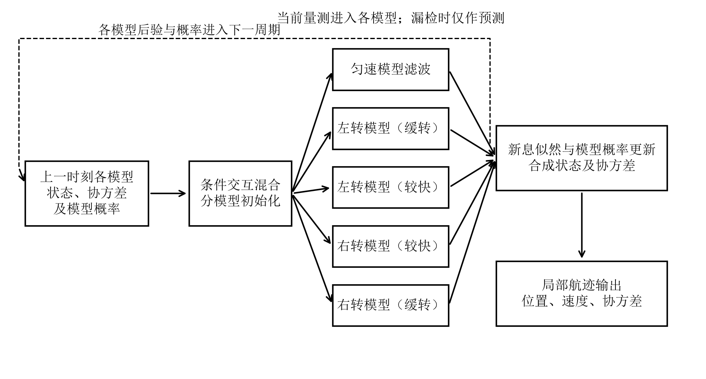{#fig:ch4_imm}

模型转移概率矩阵按平均驻留时间参数化：离开匀速模型的总转移概率取 $1-\exp(-\Delta t/2400)$ 并均分至四个转弯模型，各转弯模型返回匀速的概率取 $1-\exp(-\Delta t/360)$，转弯模型之间的总切换概率设为 0.003，其余概率保留在原模型中，各行归一化并对模型概率下限作数值保护。值得指出的是，在双照射源系统中，两站通常共用同一套运动模型集与转移参数，模型集与真实机动分布的匹配程度不仅影响单站滤波误差，还会通过共同模型误差影响两站误差相关性，相关传导机理将在第 6 章定量分析。

## 4.3 断续观测下的航迹初始化与维持

### 4.3.1 确认逻辑与窗口初始化

在 0.6 检测概率下，单站点迹存在大量随机缺帧，航迹起始需分别处理“逻辑确认”与“状态初始化”两个步骤。依据第 2 章假设 A0，单站命中点迹按已知仿真身份归入候选序列；当最近 7 个物理帧内累计命中不少于 3 次且当前帧存在有效命中时，确认航迹起始（漏检帧以空记录占位，不作人工插值补点）。

航迹确认后，综合滑窗内所有有效命中位置与多普勒观测构建加权线性最小二乘方程，联合求解起始时刻 $t_0$ 的位置与速度。单轴位置观测约束可写为

$$p_j=p_0+v(t_j-t_0)+e_j$$ {#eq:ch4_start_ls}

结合两方向位置约束与传播几何下的多普勒速度投影约束，按预设位置与多普勒误差尺度加权求解四维初始状态，并将加权信息矩阵的逆叠加不确定性下限作为初始协方差。该过程严格仅依赖起始时刻之前已获量测，不借用参考速度；若窗口解未通过可逆性或合理速度范围检验，则自动退回至两点差分初始化。

### 4.3.2 漏检预测与局部航迹输出

局部航迹建立后，有量测到达的帧执行滤波更新，漏检帧仅保留状态与协方差预测，以维持航迹输出连续性；若连续漏检达到 8 帧则判定航迹终止，此后目标重新被连续检测到时按上述滑窗规则重新起始。为避免引入未来信息，本节实验关闭任何依赖参考航迹结束时刻的人为截断逻辑。单站最终向跨源配对与融合模块输出局部航迹编号、时间戳、状态估计、协方差矩阵以及本帧更新/预测标记。

## 4.4 参数影响与滤波性能分析

### 4.4.1 仿真场景与评价方法

单站滤波实验依托覆盖互补布设的 R1 链路开展，设定生成与滤波虚高一致（300 km）且无残余系统偏置，以隔离配准误差、专门考察运动滤波性能。三通道噪声标准差分别为 $\sigma_R=10\text{ km}$、$\sigma_\theta=0.35°$、$\sigma_{v_d}=0.5\text{ m/s}$，采样周期 30 s。

验证场景涵盖受控仿真与 ADS-B 数据驱动仿真两类。受控仿真包含直线与转弯两条 1800 s（61 帧）轨迹，初始位置 110°E、30.1°N，巡航速度 230 m/s；其中直线场景全程向北匀速飞行，转弯场景在 600–1200 s 间以 0.15°/s 速率左转，前后段保持直线。ADS-B 场景选用第 3 章的转弯轨迹 T06677（77 帧）用于参数敏感性分析与性能评估，并另行引入独立转弯轨迹 T14342（10:50:28—11:22:58 UTC，66 帧）作为不参与选参的附加验证集。

实验严格隔离参数选择与性能验证样本：过程噪声扫参在 T06677 上按 20 组随机种子执行；正式性能评价则启用另外 50 组互不重叠的随机种子，在四个场景、检测概率 $P_d=0.6$ 与 $0.9$ 下配对测试 CV-UKF 与 IMM-UKF（共计 800 条试验记录）。同一种子下不同方法共享完全一致的量测噪声与命中序列，且 $P_d=0.6$ 的命中集合为 $P_d=0.9$ 的子集。

评价指标区分“共同有量测帧”（两种滤波器均有输出且当帧存在量测，用于与逐点定位公平对比）和“全输出帧”（包含漏检预测帧，用于衡量连续跟踪精度与输出比例）。位置误差按球面大圆距离计算，二维速度误差为局部东北速度误差矢量的模。滤波器对自身误差描述的可信度由归一化新息平方（NIS）与归一化估计误差平方（NEES）衡量：

$$\mathrm{NIS}_k=\boldsymbol\nu_k^T\mathbf S_k^{-1}\boldsymbol\nu_k,\mathrm{NEES}_k=\tilde{\mathbf x}_k^T\mathbf P_k^{-1}\tilde{\mathbf x}_k$$ {#eq:ch4_consistency}

在三维观测与四维状态的理想高斯匹配条件下，NIS 与 NEES 的理论期望分别为 3 与 4，单时刻名义 95% 卡方置信区间分别为 [0.2158, 9.3484] 与 [0.4844, 11.1433]。

### 4.4.2 过程噪声参数的影响与选择

由式[@eq:ch4_q_metric]可知，单个采样周期内的单向速度过程噪声标准差为 $\sqrt{q\Delta t}$。当 $q=0.02\text{ m}^2/\text{s}^3$、$\Delta t=30\text{ s}$ 时，单步速度扰动标准差仅约 0.77 m/s，在目标航向改变时极易因模型刚性过强导致跟踪滞后；增大 $q$ 则可扩大预测协方差，使观测新息及时纠正机动偏差。

固定 $P_d=0.6$ 与五模型转弯率配置（±0.05°/s、±0.2°/s），在 $q\in\{0.02,0.2,1,2,3,4,5,6,8,10,12,16,20,30\}\text{ m}^2/\text{s}^3$ 网格上（在 2–20 转折区间加密采样）开展 20 种子配对蒙特卡洛扫参，IMM-UKF 在共同有量测帧上的位置误差及一致性指标汇总于表[@tbl:ch4_q]。

| $q$ / $\mathrm{m^2/s^3}$ | 位置 RMSE / km | NIS 均值 | NEES 均值 |
| ---- | ---- | ---- | ---- |
| 0.02 | 14.86 ± 4.03 | 15.97 | 20.63 |
| 0.2 | 7.49 ± 1.41 | 9.57 | 12.71 |
| 1 | 6.25 ± 1.37 | 5.59 | 8.06 |
| 2 | 6.19 ± 1.22 | 4.43 | 6.56 |
| 3 | 6.21 ± 1.10 | 4.00 | 5.89 |
| 4 | 6.26 ± 1.02 | 3.67 | 5.44 |
| 5 | 6.30 ± 0.97 | 3.42 | 5.11 |
| 6 | 6.34 ± 0.93 | 3.22 | 4.86 |
| 8 | 6.39 ± 0.88 | 2.94 | 4.49 |
| 10 | 6.42 ± 0.85 | 2.76 | 4.22 |
| 12 | 6.45 ± 0.82 | 2.62 | 4.01 |
| 16 | 6.50 ± 0.79 | 2.45 | 3.71 |
| 20 | 6.55 ± 0.77 | 2.34 | 3.50 |
| 30 | 6.64 ± 0.74 | 2.18 | 3.20 |

: 过程噪声谱密度对 ADS-B 转弯航迹估计的影响（每组20次试验） {#tbl:ch4_q}

全范围变化趋势及 2–20 局部加密曲线如图[@fig:ch4_improvement]所示。在逐点定位平均误差恒为 11.03 km 的相同量测下，$q$ 由 0.02 增至 2 时，滤波位置 RMSE 从 14.86 km 陡降至最低点 6.19 km；随后继续增大 $q$，位置误差仅平缓回升（$q=6$、10、20 时分别为 6.34、6.42、6.55 km），而 NIS 与 NEES 均值持续单调回落，协方差由严重低估逐步向理论参考值收敛。

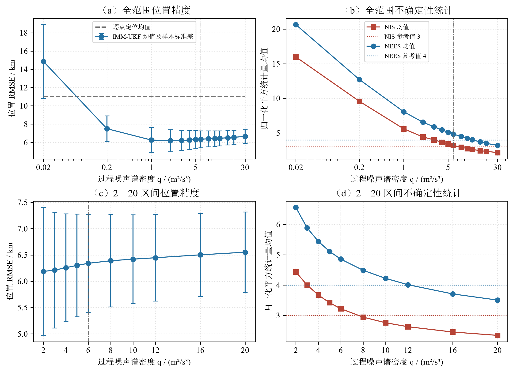{#fig:ch4_improvement}

考虑到下游跨源关联门限与融合权重均依赖局部协方差的合理性，参数选取不能仅追求位置 RMSE 极小值（$q=2$ 时 NEES 均值仍高达 6.56，协方差偏乐观）。本文采用统一的工程折中准则：要求 NIS 与 NEES 均值均落入理论参考值 ±25% 区间（即 [2.25, 3.75] 与 [3, 5]），在满足该条件的参数中取位置 RMSE 最小者。在扫描网格内，$q\in\{6,8,10,12,16,20\}$ 均满足均值约束，其中 $q=6\text{ m}^2/\text{s}^3$ 对应最低位置误差（6.34 km，NIS 3.22，NEES 4.86），遂确定为后续单站验证的选定参数。该准则属于既定扫描网格下的工程权衡，不等同于严格的卡方假设检验或全局最优解。

### 4.4.3 滤波航迹的空间与时序特征

采用选定参数 $q=6\text{ m}^2/\text{s}^3$，图[@fig:ch4_sim_tracks]与图[@fig:ch4_adsb_tracks]分别展示了纯仿真转弯与 ADS-B 转弯轨迹在独立评价首个随机种子（$P_d=0.6$）下的空间跟踪效果。两幅对比图均采用统一地理范围与等比例尺度，右图以实线与虚线分别区分量测更新段和漏检预测段，并局部放大转弯区域。

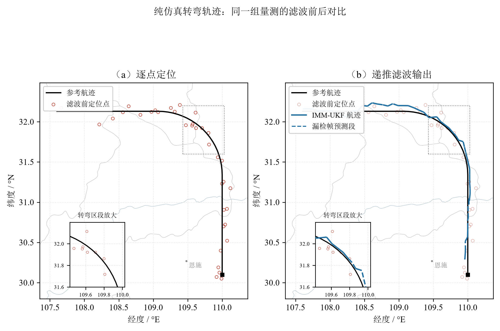{#fig:ch4_sim_tracks}

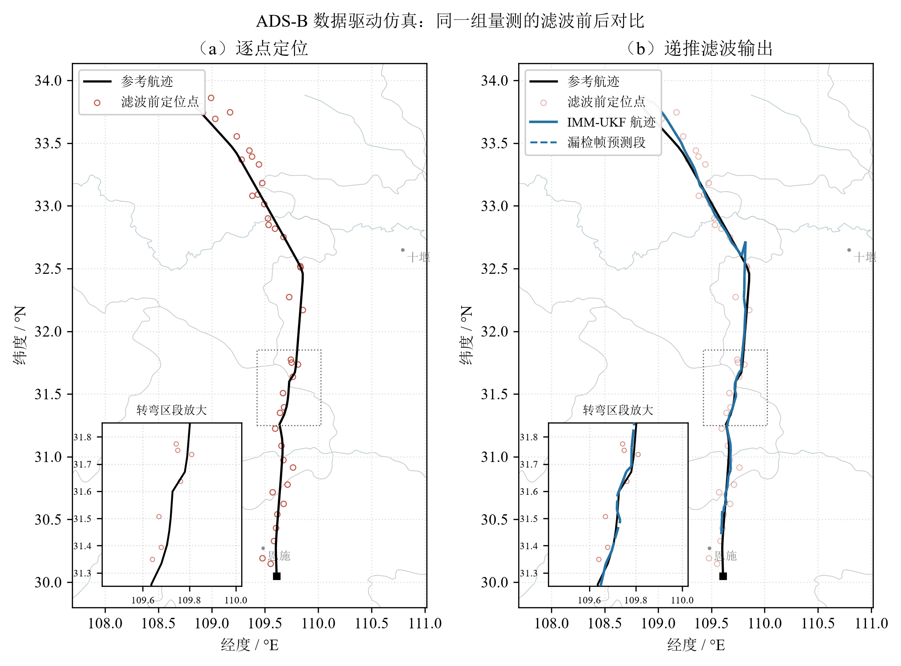{#fig:ch4_adsb_tracks}

从空间轨迹可以看出，原始逐点定位在参考航迹两侧呈现较宽的随机散布，而 IMM-UKF 在抑制随机抖动的同时能够顺畅跟随转弯航向变化，并在漏检区间依托运动模型维持连续轨迹输出。图[@fig:ch4_error_time]进一步以时间序列展示了两个转弯场景下逐点定位、CV-UKF 与 IMM-UKF 的瞬时位置误差及灰色漏检带，直观反映了滤波在转弯和连续漏检期间的误差起伏规律。

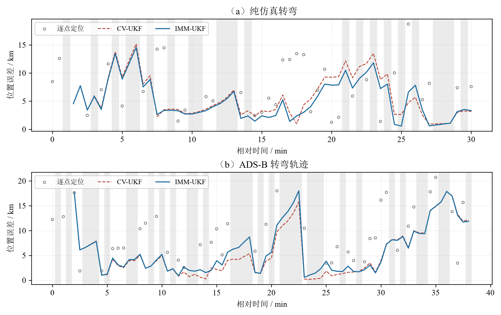{#fig:ch4_error_time}

### 4.4.4 位置精度与断续观测下的连续输出

单次轨迹演示仅具定性参考价值，定量评估须依托 50 次独立蒙特卡洛统计。表[@tbl:ch4_single]给出了 $P_d=0.6$ 时共同有量测帧的位置 RMSE 统计结果。

| 场景 | 逐点定位 / km | CV-UKF / km | IMM-UKF / km |
| ---- | ---- | ---- | ---- |
| 纯仿真直线 | 11.28 | 6.12 ± 1.66 | 6.15 ± 1.62 |
| 纯仿真转弯 | 10.96 | 7.23 ± 2.00 | 6.78 ± 1.82 |
| ADS-B T06677 | 11.05 | 6.48 ± 1.68 | 6.56 ± 1.53 |
| ADS-B T14342 | 12.09 | 7.26 ± 1.64 | 7.01 ± 1.49 |

: 选定参数下共同有量测帧的位置估计误差 {#tbl:ch4_single}

在四个场景中，IMM-UKF 相对逐点定位的平均位置误差分别降低 45.4%、38.2%、40.6% 和 42.0%。以随机种子为单位进行配对自助抽样，T06677 与独立验证轨迹 T14342 上 IMM-UKF 相对逐点定位的误差均值差分别为 −4.48 km（95% 区间 [−4.85, −4.11] km）和 −5.08 km（95% 区间 [−5.36, −4.79] km），改善具有稳定统计显著性。同时可以看到，在 $q=6\text{ m}^2/\text{s}^3$ 条件下，较大的过程噪声赋予了单模型 CV-UKF 一定的机动适应弹性，因此两者在单站位置 RMSE 上较为接近（IMM-UKF 在纯仿真转弯与 T14342 上略有优势，而在 T06677 上略逊 0.08 km）。这一结果说明，在本节所考察的缓变巡航转弯中，单站位置精度的主要提升来自时间递推滤波与合理过程噪声配置，多模型结构本身在单站场景下的独立精度优势相对有限。

表[@tbl:ch4_continuity]进一步统计了包含漏检预测帧在内的全输出帧误差与有效输出比例（CV-UKF / IMM-UKF 并列）。

| 场景 | 检测概率 | 全输出帧位置误差 / km | 二维速度误差 / m/s | 输出比例 |
| ---- | ---- | ---- | ---- | ---- |
| 纯仿真直线 | 0.6 | 6.88 / 6.89 | 42.5 / 42.8 | 93.1% |
| 纯仿真直线 | 0.9 | 5.70 / 5.72 | 49.3 / 49.5 | 96.2% |
| 纯仿真转弯 | 0.6 | 8.51 / 7.85 | 66.1 / 60.3 | 93.1% |
| 纯仿真转弯 | 0.9 | 6.82 / 6.57 | 66.0 / 64.0 | 96.2% |
| ADS-B T06677 | 0.6 | 7.07 / 7.30 | 50.5 / 52.9 | 93.9% |
| ADS-B T06677 | 0.9 | 5.31 / 5.55 | 45.9 / 48.5 | 97.0% |
| ADS-B T14342 | 0.6 | 8.16 / 7.80 | 60.4 / 56.9 | 93.0% |
| ADS-B T14342 | 0.9 | 6.57 / 6.30 | 58.0 / 54.4 | 96.5% |

: 包含漏检预测帧的状态误差与局部航迹输出比例 {#tbl:ch4_continuity}

全部 400 组“场景×检测概率×种子”组合均成功建轨；在 $P_d=0.6$ 下，依靠漏检预测维持机制，四个场景的局部航迹输出比例稳定在 93.0%–93.9%（含起始确认等待及极少数长断点终止重起的损失），当检测概率升至 0.9 时，输出比例进一步增至 96.2%–97.0%，且 IMM-UKF 全输出帧位置误差全面下降。

### 4.4.5 状态不确定性与适用范围

为检验滤波器输出的协方差能否可靠支撑下游关联门限与融合加权，表[@tbl:ch4_consistency]统计了 $P_d=0.6$ 下 IMM-UKF 的 NIS、NEES 均值、名义 95% 区间覆盖率以及二维位置 95% 误差椭圆（自由度 2 的卡方阈值 5.991）覆盖率。

| 场景 | NIS 均值 | NEES 均值 | 名义区间覆盖率（NIS / NEES） | 位置95%椭圆覆盖率 |
| ---- | ---- | ---- | ---- | ---- |
| 纯仿真直线 | 1.93 | 3.42 | 86.7% / 86.3% | 96.4% |
| 纯仿真转弯 | 2.34 | 4.39 | 91.8% / 88.5% | 94.0% |
| ADS-B T06677 | 3.21 | 5.27 | 87.3% / 87.4% | 91.7% |
| ADS-B T14342 | 2.91 | 3.53 | 89.2% / 89.5% | 95.4% |

: 选定参数下 IMM-UKF 的不确定性统计 {#tbl:ch4_consistency}

数据显示，四个场景的二维位置 95% 误差椭圆覆盖率处于 91.7%–96.4% 之间，位置维度的不确定性刻画整体接近名义水平，但在 T06677 上仍略低于 95%（91.7%）；而在完整四维状态空间内，两条 ADS-B 轨迹的 NEES 名义区间覆盖率分别为 87.4% 和 89.5%，表明仅依据均值容差选参仍不足以消除强非均匀机动或漏检引起的高阶分布偏离。此外，本节实验基于无系统偏差、站内理想关联与选定巡航轨迹的前提，若面对更剧烈机动或存在标校残差，局部协方差校准仍需结合具体场景进一步调整。

## 4.5 本章小结

本章构建了面向短波断续观测的单站 IMM-UKF 航迹滤波方法，实现了经纬度状态与局部东北物理尺度的统一转换、含完整过程噪声预测协方差的无迹更新、五模型交互概率递推以及滑窗确认与漏检维持机制。蒙特卡洛扫参清晰揭示了过程噪声谱密度 $q$ 在机动滞后与协方差一致性之间的权衡规律；按工程折中准则选取 $q=6\text{ m}^2/\text{s}^3$ 后，50 组独立随机试验表明 IMM-UKF 在四个场景中有量测帧位置 RMSE 较逐点定位降低 38.2%–45.4%（两条 ADS-B 轨迹分别降至 6.56 km 与 7.01 km），在 $P_d=0.6$ 下实现了 93.0%–93.9% 的连续航迹输出，位置误差椭圆覆盖率达 91.7%–96.4%。下一章将基于两条独立链路输出的局部航迹及其协方差，研究有限公共观测条件下的跨照射源在线航迹配对问题。

# 第5章 有限共视下的在线航迹配对

跨照射源航迹配对要在逐帧到达的局部航迹之间判断目标身份，并及时决定是否将另一站的信息接入已有系统航迹。目标较稀疏时，最近邻通常能够找到位置相近的候选；并发增加、航迹误差变大或共视时间缩短时，距离最近的航迹却未必属于同一目标。因此，本章重点考察在线配对策略在当前场景中的表现及其适用条件，不预设某一种候选判据在所有条件下占优。

在线系统的默认配置采用位置、马氏距离和速度三判据构造候选，并以最近8帧中累计6帧确认的规则接入第二站。最近邻、序贯和多证据加权方法作为同一在线链路中的对照。现有在线比较显示，几种带门限的方法在所测走廊场景中表现接近，最近邻出现误配；数据尚不足以证明多证据加权在更高并发下具有稳定优势。本章据此讨论策略选择与证据边界。

## 5.1 在线配对问题与评价口径

在时刻 $k$，两站分别提供当前有效的局部航迹集合 $\mathcal A_k$ 和 $\mathcal B_k$。每条局部航迹包含状态估计、协方差、航迹标识及其已有历史。在线配对只能使用截至当前时刻已到达的信息；仿真真值仅用于事后评价，不参与候选筛选、指派或确认。

设两条局部航迹 $a_i$ 与 $b_j$ 在当前及历史记录中具有共同有效历元集合 $T_{ij}(k)$。位置、马氏距离和速度差等证据仅在相应两条航迹均有有效状态的共同历元上计算。候选判定后，系统管理器在当前帧对候选按分值排序并执行贪心一对一指派，每条局部航迹在该帧至多分配给一条系统航迹。尚未确认的候选按航迹对分别累计，不同候选之间不共享确认计数。

在线结果以误配和漏配分别报告。输出配对若对应不同参考目标，计为误配；应当确认的同源目标对未被接入系统航迹，计为漏配。查准率为正确配对数占全部输出配对数的比例，查全率为被正确配对的目标数占实际可评价同源目标数的比例。在线主试验还分别报告已确认配对数、误配数、单源航迹延续和双源融合结果。最近邻等策略可能导致系统航迹分裂或合并，因此不同策略各自形成的候选池不一定完全相同；比较配对数时同时给出正确数和误配数，不将单独的配对总数解释为算法优劣。

为概括误配与漏配的工程影响，可定义加权代价

$$C=5N_{\text{wrong}}+N_{\text{missed}}$$ {#eq:ch5_cost}

权重5表示本研究评价时对误配赋予较高惩罚，因为错误接入会把不同目标的信息合并，漏配则主要使系统暂时维持单源状态。该权重是本章的评价设定，不是适用于所有任务的普遍代价比例；结论同时结合正确配对数和误配数解释。

第2章主场景中的63条目标航迹里，几何上有57条曾同时进入两站视场。这是潜在共视集合。端到端运行还受点迹生成、局部航迹确认和有效重叠时段影响，实际进入在线配对评价的目标数可能更少，不能直接用57替代每次运行的查全率分母。

## 5.2 候选策略与在线处理流程

在线链路提供四种候选策略。最近邻在当前有效航迹中选择位置最近者，不设置拒绝门限；序贯策略累计共现期间的马氏距离通过比例，并结合位置范围门限筛除不相容候选；双门限策略在当前帧同时检查位置距离、马氏距离和速度一致性；多证据加权策略则对共同历元上的距离、马氏通过率、速度通过率和最长连续距离合格段进行滚动累计，再依据综合分数形成当前候选。

本文端到端运行使用的默认候选策略为双门限。其一帧候选条件写为

$$d_{ij}^k<T_1,D_{ij}^{2,k}<5.99,\Delta v_{ij}^k<3\sigma_{v,ij}^k$$ {#eq:ch5_dualgate}

其中 $T_1=35\text{ km}$，$D_{ij}^{2,k}$ 为两站位置差的马氏距离平方，速度容差由两条局部航迹所报速度协方差确定。候选分值随位置距离增加而下降，系统管理器按分值由高到低处理并在当帧执行一对一冲突消解。本文实现采用逐帧贪心分配，不采用匈牙利全局指派；因此本章结论对应实际在线链路。该处理继承了航迹配对的一对一约束，但不构造跨整段航迹的全局最优指派。

系统处理顺序如图[@fig:ch5_mewf]所示。图中多证据加权仅作为候选策略选项，主链路实际采用双门限。

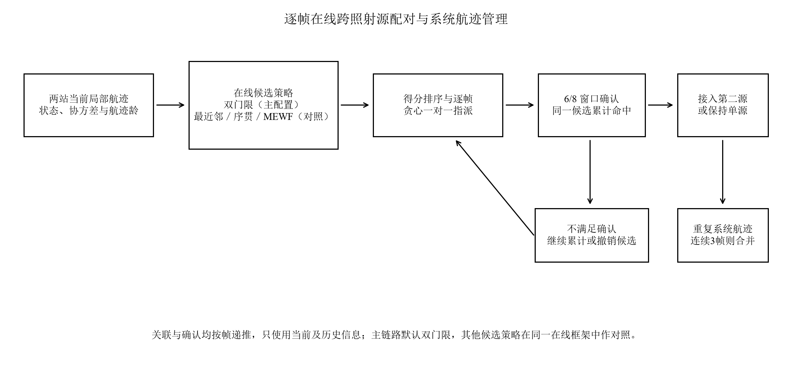{#fig:ch5_mewf}

每个候选航迹对按最近8帧的关联命中记录累计确认，至少6帧通过方可将第二站源接入系统航迹。候选身份变化时重新累计，漏掉的一帧记为未通过。局部航迹生成系统航迹后可先以单源状态维持；若两条各自持有不同站源的系统航迹连续3帧落入合并门限，则合并并保留先建立的系统航迹编号。系统航迹在任一站持续提供局部状态时继续更新，连续8帧没有任何源供给后删除。这样，候选判断、确认、源接入和重复系统航迹合并构成完整的在线生命周期。

多证据加权策略是可选对照，不是本章默认运行方法。该策略按帧累计四类证据并输出带分值候选，之后仍由上述在线管理器完成逐帧贪心指派和6/8确认；它并不调用匈牙利算法。双门限策略结构较简洁，且是当前主链路的默认配置；是否有必要增加多证据计算，应由在线对照结果和使用场景决定。

## 5.3 6/8确认规则的统计依据

多帧确认用于降低单帧偶然接近造成的误接入。为分析门限与窗口长度的关系，考虑理想位置创新统计量

$$T=\boldsymbol\nu^T\mathbf S^{-1}\boldsymbol\nu$$ {#eq:ch5_nis}

若两站位置差协方差 $\mathbf S$ 描述准确且同源误差均值为零，则二维统计量满足 $T\sim\chi_2^2$。取单帧门限 $g=5.99$，理想同源单帧通过概率为

$$p_1=F_{\chi_2^2}(g)=1-e^{-g/2}\approx0.95$$ {#eq:ch5_p1}

若异源航迹具有标准化位置偏移 $\delta/\sigma$，理想统计量近似服从自由度2、非中心参数 $\lambda=(\delta/\sigma)^2$ 的非中心卡方分布。令异源单帧通过率为 $p_0$，假定窗口内各帧独立，则最近 $N$ 帧至少 $M$ 次通过的概率为

$$\alpha(M,N)=\sum_{r=M}^{N}\binom{N}{r}p_0^r(1-p_0)^{N-r},\beta(M,N)=\sum_{r=M}^{N}\binom{N}{r}p_1^r(1-p_1)^{N-r}$$ {#eq:ch5_bin}

对给定 $M,N$，以 $\alpha=0.05$ 反求异源单帧通过率 $p_0^*$，再由非中心卡方分布反求相应偏移 $\delta_{\min}/\sigma$；同源检出率 $\beta$ 按上式计算。对于 $N=8$，统计结果如表[@tbl:ch5_confirm]所示。

| 规则 $M/N$ | 同源检出概率 $\beta$ | 5%假确认约束下最小偏移 |
| ---- | ---- | ---- |
| 4/8 | 0.99998 | $3.13\sigma$ |
| 5/8 | 0.99963 | $2.81\sigma$ |
| 6/8 | 0.99421 | $2.49\sigma$ |
| 8/8 | 0.66342 | $1.70\sigma$ |

: 理想独立帧假设下不同确认规则的判别力 {#tbl:ch5_confirm}

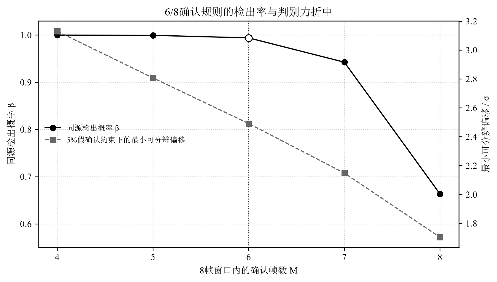{#fig:ch5_confirm}

6/8在该模型下兼顾了约0.994的同源检出概率与$2.49\sigma$的偏移分辨力；8/8的偏移分辨力更强，但同源检出概率降至约0.663。结合覆盖互补主场景约21—24帧的几何共视时长，本文在线配置采用6/8，以避免要求长串连续通过。图[@fig:ch5_confirm]展示在该理想模型下改变M所形成的检出率与判别力折中。

上述概率是协方差匹配、候选身份固定和帧间独立等理想条件下的设计参考。实际在线候选还要通过距离、速度条件，并参与候选竞争；滤波误差也可能具有时间相关性。因此，6/8及其理论概率不等于整个系统已验证的假确认率或检出率，系统性能仍以端到端在线结果为准。

## 5.4 在线策略对照与主场景结果

在线策略对照在同一覆盖互补链路中逐帧运行，各方法使用相同的场景和处理框架。表[@tbl:ch5_compare]汇总两组900帧在线比较中的输出配对数、正确数和误配数。对照A采用转弯率0.7°/s、1.5°/s模型集，对照B采用0.05°/s、0.2°/s模型集；每种策略均在逐帧在线链路中运行。表中逐行报告各方法本次运行的实际输出，不把不同策略各自形成的有效目标数混作共同分母。

| 在线比较 | 方法 | 输出配对数 | 正确配对数 | 误配数 | 查准率 |
| ---- | ---- | ---- | ---- | ---- | ---- |
| A | 最近邻 | 16 | 14 | 2 | 87.5% |
| A | 序贯 | 14 | 14 | 0 | 100% |
| A | 双门限 | 14 | 14 | 0 | 100% |
| A | 多证据加权 | 14 | 14 | 0 | 100% |
| B | 最近邻 | 23 | 19 | 4 | 82.6% |
| B | 序贯 | 20 | 20 | 0 | 100% |
| B | 双门限 | 20 | 20 | 0 | 100% |
| B | 多证据加权 | 20 | 20 | 0 | 100% |

: 两组在线链路策略对照的配对计数 {#tbl:ch5_compare}

两组策略在正确配对与误配数量上的对照见图[@fig:ch5_compare]。

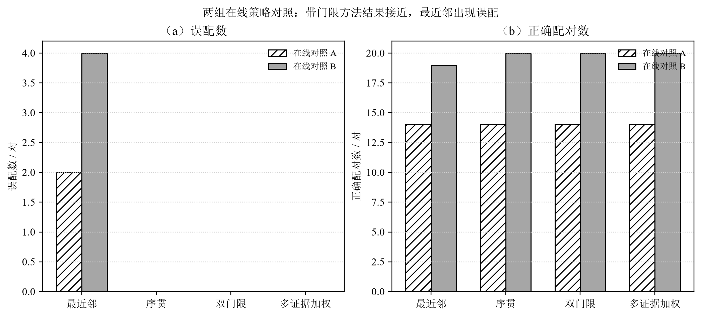{#fig:ch5_compare}

两组比较中，三种带门限策略均未出现误配，最近邻分别出现2次和4次误配。双门限与序贯的配对计数相同；多证据加权没有表现出相对双门限稳定的正确数优势。相同在线场景内，三种策略的共同帧融合RMSE差异也较小：比较A约为17.48 km，比较B约为7.43—7.50 km，且B的窄转弯模型集改变了所有方法共享的前端航迹质量。由此不能把微小融合误差差异归因于配对策略，也不能据此宣布MEWF或某个策略普遍最好。

全量1950帧的覆盖互补主场景采用默认双门限策略。37个实际具备两站确认航迹的目标对中，35对正确接入、未出现误配，查准率为100%，查全率为94.6%。这组结果说明默认策略在当前走廊交通流中能够支持在线源接入，但仍有2个可配对目标未能确认。几何上可能共视的目标数与实际形成两站确认航迹的目标数不同，评价时使用本次运行的37个实际目标作为分母，不以第2章的几何共视计数替代。

## 5.5 适用条件与当前结论

在线结果支持的策略选择是有限而具体的：在本研究覆盖互补的FR24主场景及两组在线比较中，双门限作为主链路默认策略可以实现可靠源接入；最近邻缺少拒绝机制，在相同运行中出现误配；序贯和多证据策略在这些样本中没有展示相对双门限的稳定配对优势。因此，本文将双门限保留为最终在线配置，将其他策略作为适用性对照，不把多证据加权包装成全面优胜的新算法。

当前在线主场景的目标并发均值约为6、峰值约为12。已有在线数据尚未充分覆盖更高并发、长时间平行航路和更严重协方差失配条件，故无法据此给出高密度条件下各策略性能排序，也不将较早受控对照中的误配—漏配拆分结果作为当前在线系统的验证结论。若要判断门限或候选证据在高歧义条件下的边界，还需在覆盖有效、目标确实进入两站视场的前提下补充更高密度的在线试验。

本章的核心结论是：航迹配对不存在脱离目标密度、共视时长和局部协方差质量的普遍最优算法。对当前已验证的在线走廊场景，双门限已满足配对需要，复杂候选策略未显示稳定额外收益；这一结论是本研究的适用范围判断，而不是双门限在未测试密集条件下仍最优的证明。

## 5.6 本章小结

本章建立了逐帧在线跨照射源配对流程，区分候选筛选、当前帧一对一冲突消解、6/8时序确认和重复系统航迹合并。默认在线候选策略采用位置、马氏距离和速度三判据构成的双门限方法；最近邻、序贯和多证据加权在同一在线框架中作为比较策略。理想独立帧模型为6/8规则提供判别力参考，实际链路表现则由在线仿真评价。

在已测覆盖互补走廊中，双门限主链路对37个具备两站确认航迹的目标对正确接入35对，查准率100%、查全率94.6%。两组在线比较中，带门限方法没有出现误配，最近邻出现误配；现有样本不支持复杂策略优于双门限的稳定结论。该结果明确了当前策略的适用条件，也限定了后续算法比较应覆盖的更高并发与更强歧义场景。

# 第6章 双照射源融合增益与覆盖互补

第五章说明了在线配对的条件与边界。配对成功后，融合能否改善位置估计仍取决于两站误差的相关程度和精度差异；另一方面，视场互补可以延长系统航迹，但单源延续段本身不产生双源精度增益。本章分别研究共视段融合精度和覆盖互补下的航迹长度，重点检验误差相关性、运动模型集与融合表现之间的联系，并以在线仿真结果限定结论适用范围。

## 6.1 状态融合与收益评价

两站局部航迹经时间对齐和在线配对后，向融合中心提供同一参考时刻的四维状态估计与协方差。系统以简单凸组合（SCC）的信息矩阵形式合成双源状态：

$$\mathbf P_f=(\mathbf P_1^{-1}+\mathbf P_2^{-1})^{-1},\hat{\mathbf x}_f=\mathbf P_f(\mathbf P_1^{-1}\hat{\mathbf x}_1+\mathbf P_2^{-1}\hat{\mathbf x}_2)$$ {#eq:ch6_scc_matrix}

式中状态按经度、经度变化率、纬度和纬度变化率排列。每帧融合使用当前两站局部估计，不将系统融合状态回馈两站滤波器。两站均提供有效状态时进行双源融合；仅一站存在与系统航迹绑定的有效局部航迹时透传该站估计。无源预测维持与局部滤波的漏检预测均属于航迹管理过程，不能与新量测等同；本章有效系统输出要求当帧至少存在一路有效局部源。SCC在误差独立、无偏且所报协方差准确的条件下具有最小方差性质[20]；这些条件在目标机动和残余配准误差下可能偏离，故融合收益需要单独检验。

对某一误差统计量 $Q$，定义融合相对较优单站的改善比例为

$$G_Q=\frac{\min(Q_1,Q_2)-Q_f}{\min(Q_1,Q_2)}\times100\%$$ {#eq:ch6_gain}

其中 $Q_1$、$Q_2$ 与 $Q_f$ 分别为两站局部估计和系统融合估计在相同目标、相同历元上的位置误差统计量；比较两组滤波参数时，三者均在两组都正确形成双源输出的共同历元集合上计算。$G_Q>0$ 表示融合优于该统计口径下的较优单站，$G_Q<0$ 则表示负增益。本文并列报告位置误差RMSE、中位数和90分位数，分别反映平方误差、典型误差和较大误差一侧的分布；较优单站按每组试验的整体统计量确定，而不是利用真值逐帧选择误差较小的站点。

跨模型集比较进一步取两组均正确双源输出的目标—历元交集，避免将有效融合样本变化解释为精度变化。评价时利用参考身份核验两条局部航迹同源，该身份仅用于统计，不参与在线配对。随机种子是统计重复单位，相邻时间帧不视为独立样本。双源有效帧数、单源段误差和航迹覆盖长度另行报告，使精度改善与输出可用性相互对应。

## 6.2 相关误差下的融合条件

### 6.2.1 静态标量模型的解析边界

为分析相关误差的作用，先考虑一个标量分量上的无偏估计。设两站误差方差为 $P_1=\sigma_1^2$、$P_2=\sigma_2^2$，相关系数为 $\rho$。线性融合估计及其实际误差方差分别为

$$\hat{x}_f=w\hat{x}_1+(1-w)\hat{x}_2$$ {#eq:ch6_lin}

由误差的二阶矩展开可得

$$V(w)=w^2P_1+(1-w)^2P_2+2w(1-w)\rho\sqrt{P_1P_2}$$ {#eq:ch6_var}

独立误差假设给出的逆方差权重为 $w=P_2/(P_1+P_2)$。不失一般性，令第1站为较优单站，并记标准差比 $k=\sigma_2/\sigma_1\ge1$，代入可得

$$\frac{V_{\mathrm{SCC}}}{\sigma_1^2}=\frac{k^2}{1+k^2}+\frac{2\rho k^3}{(1+k^2)^2}$$ {#eq:ch6_scc_k}

以 $V_{\mathrm{SCC}}\le\sigma_1^2$ 为非负收益条件，整理得到

$$\rho\le\frac{1+k^2}{2k^3}$$ {#eq:ch6_cond}

图[@fig:ch6_region]展示不同标准差比下的方差曲线。当 $k=1$ 时，融合方差为 $(1+\rho)P_1/2$，完全相关时与单站相等；两站精度差异增大后，容许的正相关程度下降。$k=2$、$k=3$ 时，相关系数上限分别约为0.31和0.19。两源数量增加并不自动意味着更高精度，误差结构和权重可靠性同样影响融合效果。

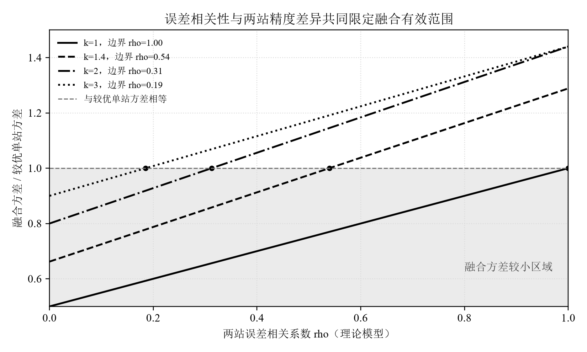{#fig:ch6_region}

该边界依赖标量误差、零均值和权重所依据的方差与实际方差一致等假设。在线SCC使用四维时变协方差矩阵，局部误差还受历史量测和机动失配影响。因此，静态模型适于说明相关性和精度差异的作用，不宜将总体误差指标直接代入曲线后推断某次在线融合必然有效。

### 6.2.2 共同误差与相关性诊断

即使两站量测噪声独立，局部滤波误差仍可能受同一目标机动、共同模型失配和残余系统偏差影响。模型集不匹配可能使两站在转弯段产生相似预测偏离，也可能改变各站协方差和模型概率。模型集对融合的影响因而需要结合单站精度、误差相关性及融合结果共同判断。

令 $\boldsymbol\delta_i(t)$ 为局部东北尺度下的二维位置误差，并定义中心化向量 $\widetilde{\boldsymbol\delta}_i(t)=\boldsymbol\delta_i(t)-\overline{\boldsymbol\delta}_i$。池化相关系数定义为

$$\rho_{\mathrm p}=\frac{\sum_t\widetilde{\boldsymbol\delta}_1(t)^T\widetilde{\boldsymbol\delta}_2(t)}{\sqrt{\left(\sum_t\|\widetilde{\boldsymbol\delta}_1(t)\|^2\right)\left(\sum_t\|\widetilde{\boldsymbol\delta}_2(t)\|^2\right)}}$$ {#eq:ch6_rho}

池化集合包含同一种子的全部共同目标—历元，每个样本均使用相同参考真值。为保留平均偏差的共同分量，同时报告未中心化的归一化交叉误差矩

$$r_{\mathrm p}=\frac{\sum_t\boldsymbol\delta_1(t)^T\boldsymbol\delta_2(t)}{\sqrt{\left(\sum_t\|\boldsymbol\delta_1(t)\|^2\right)\left(\sum_t\|\boldsymbol\delta_2(t)\|^2\right)}}$$ {#eq:ch6_rhop}

二者都描述两站位置误差的共同变化程度，但 $r_{\mathrm p}$ 同时包含平均偏差，不能称为中心化相关系数。二维位置 NEES 另用于诊断所报协方差与实际误差大小是否匹配，其理想均值为2。该诊断与相关性回答不同问题，NEES均值接近2也不单独构成完整的一致性证明。

## 6.3 模型集对融合表现的影响

### 6.3.1 在线对照与共同样本

采用第2章近共视布设及ADS-B驱动场景，场景含42段参考航迹，评价窗为240帧。两组均使用第4章完整预测协方差重采样的IMM-UKF实现，过程噪声谱密度固定为 $q=6\text{ m}^2/\text{s}^3$；采样周期为30 s，检测概率为0.6，在线配对采用双门限及6/8确认，状态融合采用SCC。两组仅改变CT模型的转弯率：较宽转弯率模型集取 $0.7/1.5^\circ/\mathrm{s}$，巡航匹配模型集取 $0.05/0.2^\circ/\mathrm{s}$。同一随机种子下的站点、点迹噪声与漏检随机流、系统偏差及校正方式相同。

参数在试验前固定，使用20个未参与第4章过程噪声扫参的随机种子，不根据本节结果重新选择参数。两组各自正确双源输出帧数的种子均值为978和952；取共同目标—历元后，每个种子可用于精度比较的样本为863—998帧，均值约946帧。精度变化在共同集合上计算，全部双源帧另用于观察输出数量与系统级表现。图[@fig:ch6_mechanism]给出本节检验的影响关系。

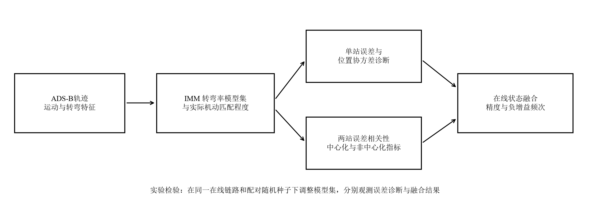{#fig:ch6_mechanism}

### 6.3.2 精度、相关性与增益分布

表[@tbl:ch6_model]给出共同集合上的种子均值及模型集变化的配对差值。置信区间由20个种子差值的均值与标准误差按 $t$ 分布计算，为单项95%区间；其统计单位是随机种子，不是相邻航迹帧。表中“巡航减较宽”对误差和相关系数为负时表示下降，对增益为正时表示改善。

| 指标 | 较宽转弯率模型集 | 巡航匹配模型集 | 巡航减较宽（95%置信区间） |
| ---- | ----: | ----: | ----: |
| 融合位置RMSE / km | 5.28 | 5.04 | −0.239 [−0.326, −0.152] |
| 融合位置误差中位数 / km | 3.57 | 3.44 | −0.130 [−0.183, −0.077] |
| 融合位置误差90分位数 / km | 8.36 | 7.87 | −0.496 [−0.603, −0.388] |
| RMSE增益 | 21.38% | 22.56% | 1.18 [0.04, 2.32] 个百分点 |
| 中位误差增益 | 19.83% | 20.61% | 0.78 [−0.65, 2.22] 个百分点 |
| 90分位误差增益 | 18.71% | 20.15% | 1.44 [0.32, 2.56] 个百分点 |
| 中心化池化相关系数 $\rho_{\mathrm p}$ | 0.225 | 0.183 | −0.043 [−0.064, −0.021] |
| 未中心化交叉误差矩 $r_{\mathrm p}$ | 0.230 | 0.185 | −0.046 [−0.067, −0.025] |

: 两种模型集在20个随机种子的共同目标—历元上的融合表现 {#tbl:ch6_model}

巡航匹配模型集下，融合RMSE、中位误差和90分位误差分别下降约4.5%、3.6%和5.9%，两种相关性诊断量也降低。两站局部RMSE由7.05、6.95 km变为6.83、6.59 km，表明模型集调整同时作用于单站误差和两站误差结构，不能把融合误差的全部变化归因于相关性单独下降。位置NEES均值在R1由1.79变为1.99，在R2由0.88变为0.93；R1更接近理论均值2，R2仍表现出协方差偏保守的迹象，尚不能认为两站均已达到完整统计一致性。

图[@fig:ch6_neg]保留各随机种子的增益而不只给出平均值。两种模型集在RMSE、中位数和90分位口径下均未出现负增益种子，说明当前处理条件下SCC已经具有稳定的样本内收益。巡航匹配组的RMSE与90分位增益均值分别进一步增加约1.18和1.44个百分点，增量较小；中位增益配对差值的置信区间包含零。因而，这组结果支持将巡航匹配模型集作为当前民航场景的工程选择，但不支持将它表述为消除融合失效的唯一条件，也未证明两档之外的模型集选择为最优。

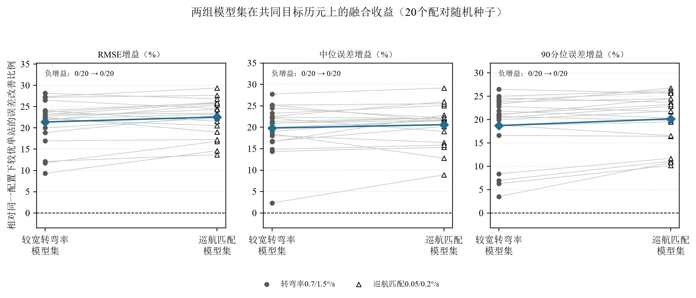{#fig:ch6_neg}

当按各组自身全部正确双源帧统计时，两组融合RMSE均值分别为5.35和5.06 km，RMSE相对增益分别为22.78%和22.48%。这一口径下较宽组的相对增益略高，而巡航组的绝对误差仍较低，原因是参与评价的目标—历元和较优单站误差基准同时变化。共同样本比较用于识别精度差异，全部输出比较用于描述系统实际表现；二者结果不能互相替代。总体而言，模型集匹配与单站误差、误差相关性和融合精度的改善相伴随，但在当前已验证的滤波参数下，额外收益主要表现为进一步降低位置误差，而非使融合从普遍失效转变为有效。

## 6.4 覆盖互补与持续跟踪

### 6.4.1 几何覆盖、局部航迹与系统输出

令 $\mathcal G_i$ 为参考目标位于第 $i$ 站视场内的历元集合，$F_i=|\mathcal G_i|$，公共覆盖帧数为 $O=|\mathcal G_1\cap\mathcal G_2|$。两站几何覆盖并集满足

$$F_{\mathrm{union}}=F_1+F_2-O$$ {#eq:ch6_union}

为衡量持续跟踪，将 $\mathcal C$ 定义为某一系统航迹编号在该参考目标评价窗内正确输出且至少有一路有效源的历元集合。几何覆盖实现率取

$$\eta_{\mathrm{cov}}=\frac{|\mathcal C\cap(\mathcal G_1\cup\mathcal G_2)|}{F_{\mathrm{union}}}$$ {#eq:ch6_eta}

该定义只计算覆盖并集内的正确系统输出，预测延续到视场之外的帧不增加几何实现率；同一目标若发生航迹分裂，只取输出帧数最多的一个系统编号，不以事后拼接多个编号替代在线连续航迹。将分子、分母同时除以较长单站几何覆盖帧数，可得同口径的几何比较关系

$$\frac{|\mathcal C\cap(\mathcal G_1\cup\mathcal G_2)|}{\max(F_1,F_2)}\le\frac{F_1+F_2-O}{\max(F_1,F_2)}$$ {#eq:ch6_bound}

此外，实际航迹长度比采用系统有效输出帧数与较长单站局部航迹帧数之比，在相同评价窗和覆盖并集内分别计数。几何覆盖帧、局部航迹输出帧和系统输出帧并不相同：漏检预测可能延续至单站视场之外，航迹确认和分裂又会减少有效输出。因此，实际航迹长度比不能直接除以几何上限后称为覆盖实现率。

### 6.4.2 典型穿越工况的在线验证

构造垂直穿越、45°斜穿、近距和远距四种单目标航路，速度固定230 m/s，每种工况采用5个随机种子。单站滤波、配对确认和融合参数与本章选定配置一致；系统偏差置零以隔离覆盖和航迹管理的作用。表[@tbl:ch6_ceiling]同时列出几何覆盖和在线航迹结果。

| 工况 | R1 / R2 / 共视几何帧数 | 并集 / 较长单站几何帧数 | 实际航迹长度比（均值 ± 标准差） | 几何覆盖实现率（均值 ± 标准差） |
| ---- | ----: | ----: | ----: | ----: |
| 垂直穿越 | 53 / 54 / 20 | 1.611 | 1.469 ± 0.028 | 95.9% ± 2.4% |
| 45°斜穿 | 35 / 65 / 28 | 1.108 | 1.012 ± 0.012 | 95.3% ± 1.6% |
| 近距穿越 | 49 / 49 / 18 | 1.633 | 1.469 ± 0.015 | 95.5% ± 1.7% |
| 远距穿越 | 57 / 59 / 24 | 1.559 | 1.456 ± 0.031 | 93.9% ± 3.0% |

: 四种穿越工况的覆盖几何与在线持续跟踪结果（每工况5个随机种子） {#tbl:ch6_ceiling}

图[@fig:ch6_ceiling]中，系统输出与几何并集均使用较长单站几何覆盖帧数归一化，连线长度反映未被有效系统输出覆盖的部分。四种工况的平均几何覆盖实现率为93.9%—95.9%。45°斜穿工况下，一站几乎已经覆盖完整穿越过程，另一站补充的几何空间有限，实际航迹长度比仅约1.012。这说明航迹延长首先依赖视场互补程度和穿越方向，不能将某一航向下的延长比例推广为普遍性能。

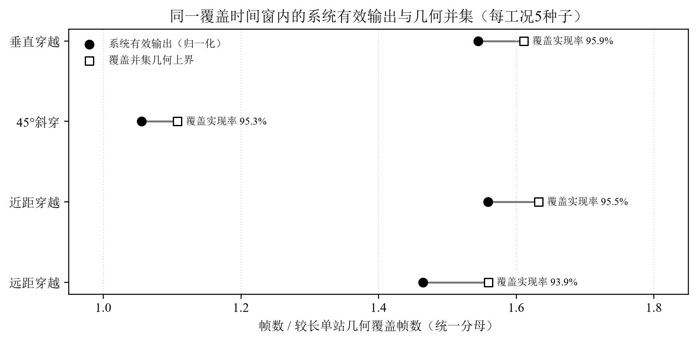{#fig:ch6_ceiling}

图[@fig:ch6_sim_relay]以固定随机种子的垂直穿越为例，将地理轨迹、位置误差和覆盖接力时间轴对应起来。目标先由南侧站覆盖，进入公共区域后接入第二源，离开公共区域后由另一站延续。几何共视与系统双源输出的时间范围并不完全相同，反映了局部建轨、配对确认及预测维持的作用。单个示例用于解释接力过程，定量结果以表[@tbl:ch6_ceiling]为准。

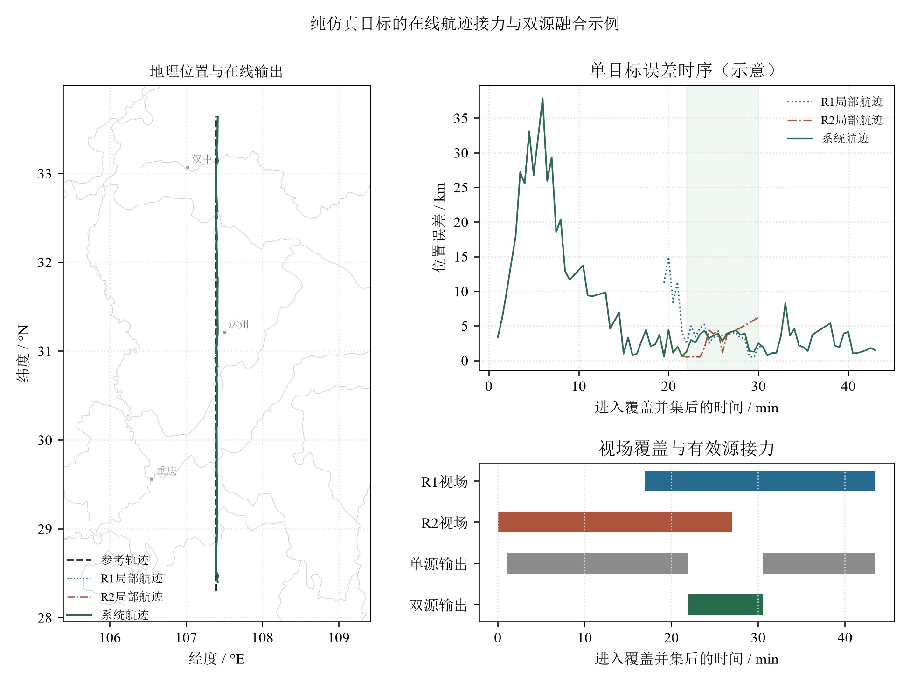{#fig:ch6_sim_relay}

### 6.4.3 ADS-B驱动场景的分段性能

在第2章63段覆盖互补场景中，采用三参数配准、巡航匹配模型集及本章选定的滤波与在线管理参数，运行3个新的随机种子。每次均有59段目标形成有效局部航迹，其余参考航段不纳入实际航迹长度比的平均分母，几何覆盖统计仍保留全部参考目标。本次评价包含2033个时间帧，表[@tbl:ch6_base]报告各随机种子内的分段精度及按目标平均的航迹长度。

| 指标 | 3种子均值 ± 标准差 | 统计对象 |
| ---- | ----: | ---- |
| 双源段融合位置RMSE / km | 5.13 ± 0.19 | 全部正确双源有效帧 |
| 双源段位置误差中位数 / km | 3.54 ± 0.28 | 同上 |
| 双源段位置误差90分位数 / km | 8.00 ± 0.15 | 同上 |
| RMSE / 中位 / 90分位增益 | 24.0% / 18.7% / 22.2% | 相对同帧较优单站，种子均值 |
| 单源段位置RMSE / km | 8.11 ± 0.22 | 单源维持段 |
| 正确双源输出占比 | 21.9% ± 1.0% | 单源及正确双源输出的目标—历元总数 |
| 实际航迹长度比 | 1.265 ± 0.007 | 59段有局部输出目标，覆盖并集内最长系统编号帧数/较长局部航迹帧数 |

: 63段ADS-B驱动覆盖互补场景的分段性能（3个随机种子） {#tbl:ch6_base}

系统平均有效输出长度为较长单站局部航迹的1.265倍，即平均延长约26.5%，但只有约21.9%的有效目标—历元属于双源输出；大部分时段依靠单站维持。双源融合RMSE为5.13 km，单源段为8.11 km。由于两类时段的观测几何、机动程度和样本集合不同，不能将二者直接相减解释为融合的因果收益；双源精度收益应采用同帧单站对照，表中三种误差口径的增益均为正。

图[@fig:ch6_adsb_relay]展示一条具有两站单独覆盖和公共覆盖区间的ADS-B航迹。示例从首个评价种子中按双源输出帧数优先、总输出帧数次之选择，未依据误差大小筛选。图中源接入与退出会改变有效输出时段，单条示例仅用于解释接力与融合过程，航迹延长结论以跨种子系统统计为依据。

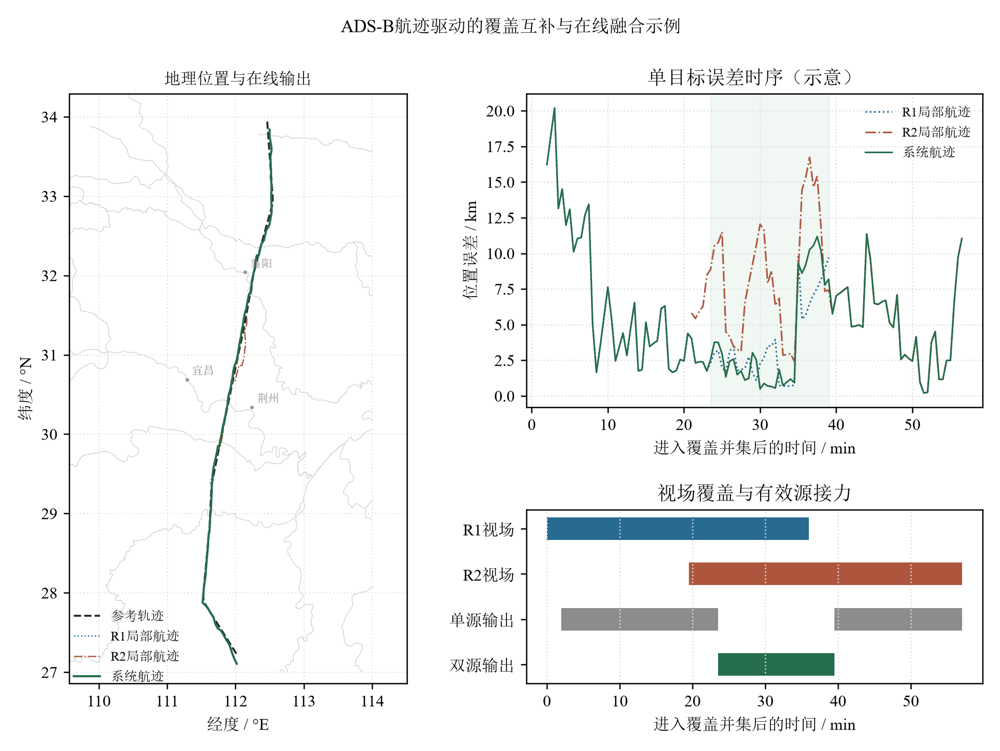{#fig:ch6_adsb_relay}

## 6.5 本章小结

本章以SCC为在线融合方法，分别研究双源精度与覆盖互补的持续跟踪收益。静态标量模型说明，误差正相关和两站精度不均衡共同限制逆方差加权的有效范围；四维在线融合需要以实际误差验证。采用 $q=6\text{ m}^2/\text{s}^3$ 及滤波实现后，20个配对种子的共同历元比较中，巡航匹配模型集使融合RMSE由5.28 km降至5.04 km，90分位误差由8.36 km降至7.87 km，两种模型集在本组试验中均未出现负增益。相关性变化与精度改善同时出现，但额外增益有限，不能将模型集匹配表述为融合有效的唯一条件。

四种穿越工况的平均几何覆盖实现率为93.9%—95.9%，实际延长幅度随航向与覆盖重叠关系变化。63段ADS-B驱动场景中，系统航迹长度比为1.265，双源段融合RMSE为5.13 km、单源段为8.11 km；同帧对照下，RMSE、中位与90分位增益分别为24.0%、18.7%和22.2%。这些结果表明，覆盖互补扩大可持续跟踪时段，双源融合改善公共有效段的状态估计，二者需使用独立口径评价，且结论限于当前模型和在线处理条件。

# 第7章 总结与展望

本文围绕天波短波外辐射源雷达双照射源的航迹关联与融合问题，构建了涵盖双基地天波量测建模、多航迹联合时空配准、断续观测单站滤波、跨照射源在线配对以及覆盖互补下在线状态融合的研究链路。针对双照射源协同处理中的核心问题——双链路时空基准如何统一、有限共视下如何在线配对以及配对后的融合在何种条件下产生收益，全文通过理论分析、蒙特卡洛试验与 ADS-B 航迹驱动的在线仿真进行研究。

## 7.1 主要结论

在布设分工与量测建模方面，双照射源系统的误差分集与覆盖分集对应相反的几何布设需求，评估口径须严格区分。近共视布设用于检验共视区内的多源融合精度；覆盖互补布设经视差补偿（波束偏转 4.6°）后在目标走廊形成 366 km 与 373 km 两条错位覆盖带，共视带 142 km，覆盖并集拓展至 597 km。由于单源延长段不产生精度增益，文中将共视段融合精度与覆盖并集航迹长度分别核算。

在双照射源时空配准方面，天波传播参数以非线性方式进入群距离（在 1400 km 处单程路径较地面距离多出约 123 km，近远端虚高灵敏度 3.11 与 1.20 相差约 2.6 倍），无法由常值距离偏置吸收，必须与时基距离偏置及方位偏差联合参数化估计。Fisher 信息矩阵分析表明，虚高与距离偏置的局部分离取决于标校样本的灵敏度变异系数 $\mathrm{CV}(s)$，放大因子 $\alpha=\sqrt{1+\mathrm{CV}^2(s)}/\mathrm{CV}(s)$ 定量刻画了距离跨度与样本数的乘积效应。10 种子重复标校实测标准差为理论下界的 1.04 至 1.26 倍；在独立 ADS-B 转弯航迹 T06677 示例中，三参数配准将逐点定位 RMSE 由 89.0 km 压降至 12.0 km；在 0–40 km 初始虚高失配对照中，不配准时共视融合 RMSE 由 8.98 km 恶化至 30.07 km（增益由 41.9% 降至 8.5%），启用三参数配准后各档融合 RMSE 均恢复至约 8.99 km（增益保持 41.9% 左右）。

在单站机动目标滤波方面，针对低检测概率（$P_d=0.6$）与长采样间隔（30 s）下的断续观测，采用经纬度—物理尺度转换、含完整过程噪声预测协方差的 IMM-UKF 以及滑窗确认与漏检预测维持机制，可稳定形成连续局部航迹。蒙特卡洛扫参表明，过程噪声谱密度 $q$ 调节机动滞后与协方差一致性之间的平衡；兼顾位置精度与 NIS/NEES 均值取 $q=6\text{ m}^2/\text{s}^3$ 后，独立验证中四个场景的有量测帧位置 RMSE 较逐点定位降低 38.2%–45.4%（两条 ADS-B 航迹分别为 6.56 km 与 7.01 km），连续输出比例达 93.0%–93.9%。在该过程噪声水平下，CV-UKF 与 IMM-UKF 的单站位置精度较为接近，且完整四维状态的协方差一致性仍有一定偏离。

在跨照射源在线配对方面，主链路采用位置、马氏距离与速度三判据形成在线候选，以逐帧一对一冲突消解和6/8累计确认完成第二站源接入。理想协方差匹配、帧间独立假设下的非中心卡方与二项分布分析，为6/8规则提供约0.994同源检出概率及$2.49\sigma$偏移分辨力的设计参考；该值不直接代表端到端系统概率。1950帧覆盖互补主场景中，37个实际双站确认目标对有35对正确接入，查准率100%、查全率94.6%。两组在线对照里，双门限、序贯与多证据加权均未出现误配，最近邻分别出现2次和4次误配；现有样本不支持MEWF相对双门限具有稳定优势，也未覆盖足够高的并发度来确定密集条件下的策略排序。

在航迹融合方面，静态标量模型下逆方差加权的非负收益条件为 $\rho\le(1+k^2)/(2k^3)$，其中 $k$ 为两站误差标准差之比；该条件用于分析相关性和精度不均衡的影响，不是四维在线融合的严格保证。采用第4章滤波实现与 $q=6\text{ m}^2/\text{s}^3$ 后，20个种子共同目标—历元对照中，巡航匹配模型集使融合RMSE由5.28 km降至5.04 km，90分位误差由8.36 km降至7.87 km，中心化池化相关系数由0.225降至0.183；两种模型集均未出现负增益，模型集匹配的额外收益有限。覆盖互补63段场景、3个种子中，59段有局部输出目标的平均实际航迹长度比为1.265，正确双源段RMSE为5.13 km，单源段为8.11 km；同帧较优单站对照的RMSE、中位和90分位增益为24.0%、18.7%和22.2%。四种穿越工况各5个种子的几何覆盖实现率均值为93.9%—95.9%。

表[@tbl:ch7_sum]汇总了全链路五个环节的决定性物理量、核心结论及适用边界。

| 环节 | 决定性量 | 结论 | 边界 |
| ---- | ---- | ---- | ---- |
| 量测 | 虚高灵敏度 $s$ | 偏差随距离变化，必须参数化 | 标量虚高、单跳传播 |
| 配准 | 距离跨度 $\mathrm{CV}(s)$ | $\sigma_{\Delta R}=\alpha\sigma_R/\sqrt N$ | 标校集与评估集分离 |
| 滤波 | 过程噪声与运动模型 | 综合位置精度和不确定性选择参数 | 本文固定轨迹与检测条件 |
| 配对 | 候选门限与在线命中序列 | 双门限主链路：35/37正确接入，查准率100% | 当前并发均值约6、峰值12 |
| 融合 | 相关系数 $\rho$ 与标准差比 $k$ | $\rho\le(1+k^2)/(2k^3)$ | 静态界只作趋势律 |

: 五个环节的决定性量、结论与适用边界 {#tbl:ch7_sum}

## 7.2 方法性贡献

第一，建立了天波双基地三参数配准的解析可辨识性刻画。通过构造群距离参数的 Fisher 信息矩阵并闭式求逆，明确指出灵敏度变异系数 $\mathrm{CV}(s)$ 而非相关系数或单纯样本数量是决定虚高与距离偏置分离精度的关键，由此导出标校航迹应按距离分层采集的工程准则（并由 R2 样本多于 R1 而标准差更大的仿真结果加以印证）。

第二，建立了与实际系统管理器一致的跨照射源在线配对分析框架。本文明确区分候选策略、逐帧一对一冲突消解与6/8时序确认，并以理想统计模型分析确认规则的检出率和偏移分辨力；在线对照显示双门限在当前走廊场景已能完成可靠接入，复杂候选策略的额外收益及其高并发适用性仍需更具区分度的在线场景检验。

第三，给出了相关误差下逆方差加权的静态有效条件，并建立共同目标—历元的在线融合对照口径。理论分析区分误差相关性与两站精度差异的作用，固定滤波参数的种子对照显示模型集匹配伴随单站误差、相关性和融合误差改善，同时限定其额外收益幅度，避免将多种因素的共同变化归因于单一相关系数。

第四，建立了覆盖互补下几何覆盖与实际航迹输出分开的评价方法。覆盖并集决定可用观测时段，几何覆盖实现率只计并集内同一系统编号的正确输出；实际航迹长度比另以较长单站局部航迹为参照。四种穿越工况与ADS-B驱动场景表明，系统能够延续单站覆盖外的航迹，延长比例受航向及覆盖重叠约束。

## 7.3 适用边界

为保证结论严谨，全文工作需在以下五个前提边界内理解。首先，验证数据属于实测航迹驱动仿真：目标运动真值取自实测 ADS-B 航迹（水平精度约 30 m，相对 10 km 级雷达误差可忽略），但群距离、方位、多普勒观测及检测过程均由物理模型仿真生成，因此当前结果尚不等同于真实短波回波外场实测，传播模型本身的结构误差有待实测检验。

其次，运动与传播模型限定于高空巡航二维平面（高度 20000 ft 以上）及单跳标量等效虚高，且依据假设 A0 将单站内部点迹—航迹关联视为理想；若放宽 A0 引入密集杂波与站内误关联，其污染将向后端跨源配对与融合传导。

再次，模型集对照为一个近共视场景上的20个配对种子，覆盖工况各5个种子，完整覆盖互补场景为3个种子，尚不足以覆盖不同交通流、传播扰动及更高目标并发条件。不同误差统计量、共同样本与全部输出口径可能给出不同增益排序，应保留相应分母及多口径报告。

此外，解析边界使用静态标量真实方差，实际SCC按时变四维报告协方差加权；局部滤波历史、方向差异及协方差失配均可能使总体统计偏离标量关系。研究工程的BC分支包含互协方差近似递推，但本章仅以SCC形成正式结果，尚未评估该近似的有效性及与CI等方法的差异。覆盖互补也不改变量测噪声，其持续监视收益与双源精度收益需分别评价。

## 7.4 后续工作

围绕上述边界，后续研究可从五个方向进一步深化。在融合理论层面，可进一步分析局部滤波时序相关、方向相关性及报告协方差失配，并核验BC分支的近似互协方差递推；在相同在线输入上比较SCC与保守融合方法的精度和一致性，建立适合时变矩阵权重的分析条件。

在前端关联集成层面，可放宽站内理想关联假设 A0，将杂波环境下的单站数据关联与站间跨源航迹配对纳入联合优化框架，定量考察站内误配与航迹碎片对跨源门限及融合权重的耦合影响。

在电离层传播建模层面，可突破标校窗口内标量恒定虚高的限制，建立随经纬度与时间缓变的二维时空虚高场模型，以抑制电离层空间梯度引起的 $h$–$\Delta R$ 耦合漂移并提升长航迹标校精度。

在系统规模扩展层面，当照射源数量增至三个及以上时，跨源配对将由二维二分图指派拓展为多维指派问题，需针对多源部分可见、异步确认与组合一致性重构代价函数与航迹管理机制。

在工程验证层面，亟需结合真实短波外辐射源外场录取回波数据，在包含实际电离层扰动、多径传播与复杂背景杂波的实测条件下复现并检验整套配准、滤波、配对与融合链路，推动方法由仿真验证走向工程实用。

双照射源联合处理在公共有效时段合成状态估计，并在视场互补时延续系统航迹。融合收益受局部误差及协方差质量影响，航迹延长受覆盖几何与在线管理制约；分别检验两类收益及其适用范围，能够形成更准确的系统评价。
